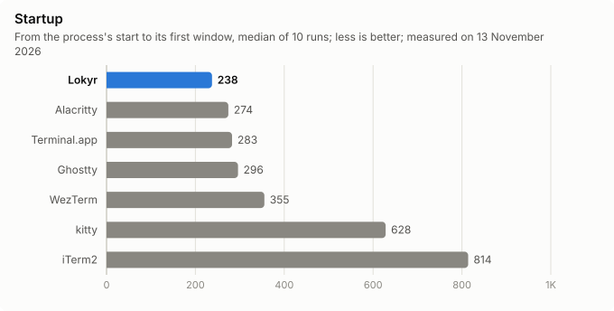
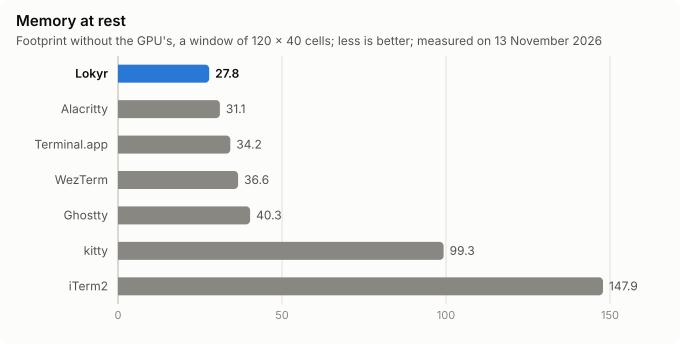
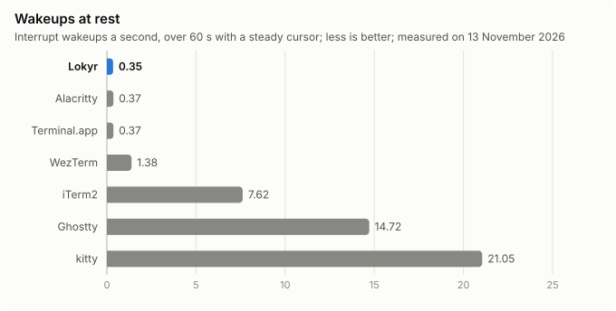
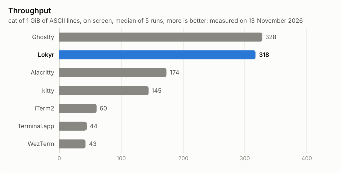
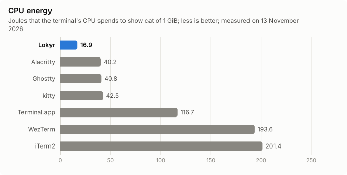
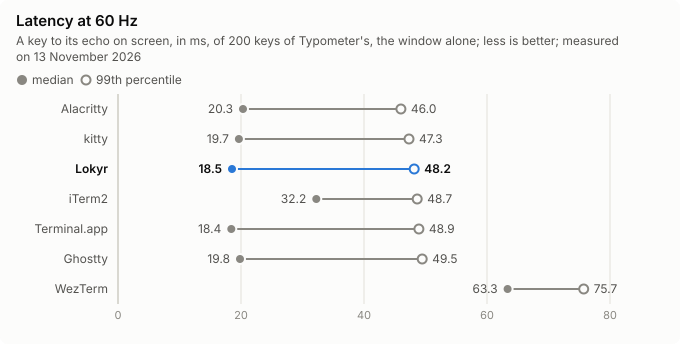
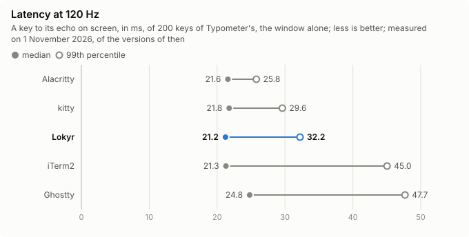

<p align="center">
  
</p>

<h1 align="center">Lokyr</h1>

<p align="center">
  <b>A fast terminal for macOS, written in Rust, where every visible feature is a plugin.</b>
  <br>
  Third-party plugins are sandboxed Luau scripts, installed by <b>Sleip</b>, its package manager.
</p>

<p align="center">
  <a href="#why-lokyr">Why Lokyr</a> ·
  <a href="#status">Status</a> ·
  <a href="#performance">Performance</a> ·
  <a href="#bundled-plugins">Plugins</a> ·
  <a href="#building">Building</a> ·
  <a href="docs/README.md">Documentation</a> ·
  <a href="CONTRIBUTING.md">Contributing</a> ·
  <a href="#supporting-lokyr">Support</a>
</p>

<p align="center">
  <a href="https://github.com/sephiroth74/lokyr/actions/workflows/ci.yml"></a>
  
  
  <a href="LICENSE"></a>
</p>

> [!IMPORTANT]
> **Lokyr is not ready for daily use yet.** Its terminal core is done, and its macOS app has tabs, splits, search and themes; the command palette and third-party plugins come next. See the [status](#status).

<p align="center">
  
</p>

## Why Lokyr

- **A small core, and plugins for the rest.** The tab bar, splits, search and the command palette are plugins, on the same API that third parties get. The core keeps the terminal itself: the screen, the input, the rendering. Leave a plugin out, and Lokyr is a terminal without it.
- **Plugins you can trust.** A third-party plugin is Luau source, in a VM of its own, with a memory limit and a deadline. It reaches the screen, the clipboard, files or the network only through the capabilities that it declares, which Sleip shows at install and Lokyr asks for on first use. The app itself contains no networking code.
- **Fast where you feel it.** Its own VT core, with 8-byte cells and a paged grid; a Metal renderer, one surface per window; a frame of steady output in about a quarter of a millisecond at 4K. It is measured against six other terminals, each change against the builds before it, and the numbers are [in the repository](docs/bench/).
- **Native on macOS.** An AppKit window, CoreText shaping and font fallback, input methods, Secure Keyboard Entry, a quick terminal on a global key.
- **Ready for agents.** A tab tells what the AI agent in it is doing, as Claude Code, Codex or Gemini CLI: at work, waiting for you, or done, of no setup, as [`[agents]`](docs/CONFIGURATION.md#agents) tells, with a notification and the Dock's badge while you look elsewhere, and ⌥⌘A to the next one that waits. Lokyr will be an [MCP server](docs/ROADMAP.md#f3b--mcp-and-agents) too: an agent works in its own pane and the panes it opens.

## Status

Lokyr is built in phases, each with exit criteria that are measured, not assumed ([roadmap](docs/ROADMAP.md)):

| Phase | What it brings | Status |
|---|---|---|
| F0 | Foundations: the workspace, CI, the measuring tools, the plugin runtime chosen | ✔ |
| F1 | The headless terminal core, checked against xterm, `alacritty_terminal` and fuzzers | ✔ |
| F2 | The macOS app, a window of one pane | 🚧 |
| F3 | The macOS MVP: tabs, splits, search, themes, the command palette | 🚧 |
| F3b | MCP and agents | |
| F4 | Third-party plugins in Luau, Sleip and its registry | ✔ |
| F5 | Shell integration, iTerm2's power features, images | |
| F6 | 1.0 | |
| F7 | Linux | |

## Performance

Lokyr against Ghostty, Alacritty, kitty, WezTerm, iTerm2 and Terminal.app, under the same conditions: Menlo 13 in 120 × 40 cells, the same plain shell, release builds, on an M5 Pro. Every terminal was measured of its version of 13 November 2026, in one session, beside Lokyr of 1.0.0's code, as [the full report](docs/bench/compare-F3-268.md) tells, with every measure, its method and its limits; the latency at 120 Hz, by Typometer, is of 1 November, of the versions of then ([its report](docs/bench/compare-F2-134.md)). Each release's own measures, against its budgets and the best of the others, are in [the releases' table](docs/bench/RELEASES.md).

<p align="center">
  
  
  
  
  
  
  
</p>

## What works today

<p align="center">
  
</p>

- ✔ Windows drawn with Metal, at the display's refresh rate, their frames only when something changed.
- ✔ Tabs, in a bar at the top, at the bottom or down a side, in three looks, dragged between windows and onto panes, a program's progress round its tab.
- ✔ Split panes, their dividers dragged, the panes without the keyboard faded.
- ✔ A find bar that highlights every match, through 100 000 lines in about 25 ms, and marks them along the panes' scroll bars, which show as macOS's do.
- ✔ Shell integration for zsh, bash and fish: jumps between prompts, a mark of each command's outcome, the command at the pane's top as its output scrolls, a notification as a long one ends.
- ✔ Fonts through CoreText: fallback, ligatures, bold and italic faces or their synthesis, emoji, box drawing and powerline symbols drawn to the cell.
- ✔ xterm's sequences, the kitty keyboard protocol, synchronized output, OSC 8 links, OSC 52 with consent, Unicode 18's grapheme clusters and widths.
- ✔ Input methods, Secure Keyboard Entry, Option as Meta, chords and leaders in the keys.
- ✔ Inline images, of iTerm2's protocol and of kitty's graphics protocol, as `imgcat`, `kitten icat`, `chafa`, `timg` and `yazi` send them, within 64 MiB a pane.
- ✔ AI agents on their tabs, working, waiting for you or done, Claude Code's of its hooks, and ⌘-click on a path's line in your editor.
- ✔ Selection, copy on select, a copy mode of vi's keys through the scrollback, paste with a check of what it holds, drag and drop of files.
- ✔ A quick terminal on a global key, from any edge of the screen.
- ✔ Windows, tabs and splits that open again as Lokyr starts, each pane in its folder; New Lokyr Window Here and New Lokyr Tab Here in the Finder, and a folder dropped on the Dock's icon; Lokyr as the default terminal of scripts, `ssh` and man pages' links.
- ✔ Notifications, the bell, smooth cursor blinking that the window server draws.
- ✔ A config in TOML, applied as it is saved, its errors shown in the window.
- ✔ English and Italian, as the system's language is, or as the config says.

## Bundled plugins

Every feature beyond the terminal itself is a plugin, and these come with the app, built into it, on the same API as third-party plugins. Each can be turned off with `enabled = false` in its section of the config, and has its own keys there.

| Plugin | What it does |
|---|---|
| [`keymap-macos`](docs/plugins/keymap-macos.md) | The default shortcuts of macOS's apps: ⌘N, ⌘C, ⌘V, ⌘T, ⌘F and the rest |
| [`core-actions`](docs/plugins/core-actions.md) | Copy and paste, select all, clear, scrolling, and the text's size |
| [`links`](docs/plugins/links.md) | ⌘-click opens a link, a URL or a path, as a compiler's `src/main.rs:42` |
| [`tabs`](docs/plugins/tabs.md) | The tab bar: new, close, select, move, rename, color, and out to a window of its own |
| [`splits`](docs/plugins/splits.md) | Split panes: split, focus by direction, resize, zoom, equalize, swap |
| [`search`](docs/plugins/search.md) | The find bar: a pane's search as you type, its matches highlighted |
| [`command-palette`](docs/plugins/command-palette.md) | The command palette: every command, ranked as you type, the recent ones first |
| [`quick-terminal`](docs/plugins/quick-terminal.md) | The quick terminal: a window that a global key slides in from an edge of the screen, over every app |
| [`progress`](docs/plugins/progress.md) | The programs' progress, of OSC 9;4, in a thin bar across the window's top |
| [`command-header`](docs/plugins/command-header.md) | The command whose output you are looking at, at the pane's top, which a click scrolls to |
| [`copy-mode`](docs/plugins/copy-mode.md) | The copy mode: ⇧⌘C, then vi's keys move a cursor through the scrollback, select and copy, without the mouse |
| [`quick-tips`](docs/plugins/quick-tips.md) | A tip at the start, once a week at most: a shortcut as your keymap binds it, or a feature that shows in no menu |

Each page tells the plugin's commands, their keys, its config and what turning it off takes away; [the plugins' index](docs/plugins/README.md) tells how they fit together.

To write a plugin of your own, in Luau, and publish it on [pkg.lokyr.dev](https://pkg.lokyr.dev), follow [Writing a plugin](docs/plugins/authoring.md).

## Install

Lokyr runs on macOS 26 or later, on Apple Silicon. Download the DMG of the latest release from [the releases](https://github.com/sephiroth74/lokyr/releases), or install it with Homebrew:

```sh
brew install --cask sephiroth74/tap/lokyr
```

The cask links `lokyr` and `sleip` into Homebrew's `bin`, and leaves Lokyr's updates to Lokyr, which takes them through Sparkle. `brew uninstall --zap --cask lokyr` takes away the app, its config, its plugins and its caches.

## Building

Lokyr needs macOS 26 or later on Apple Silicon, Xcode 27 with its Metal toolchain, and [just](https://github.com/casey/just). `rust-toolchain.toml` pins Rust.

```sh
git clone https://github.com/sephiroth74/lokyr.git
cd lokyr
just bundle             # target/Lokyr.app
open target/Lokyr.app
```

`just ci` runs what CI runs: formatting and clippy, the build and the tests, the Linux check of the portable crates, the dependencies' licenses, the comments and the docs' links, and the bundle.

## Configuration

Lokyr reads `~/.config/lokyr/config.toml`, and applies it as you save it. `lokyr +show-config --default --docs` prints every key with its default; the [configuration guide](docs/CONFIGURATION.md) explains each, and [Making a theme](docs/themes/authoring.md) tells how to write a theme of your own colors.

```toml
[font]
family = "JetBrains Mono"
size = 14

[window]
background-opacity = 0.9
background-blur = 20

[plugins.quick-terminal]
position = "top"
```

## Programs' progress

Lokyr shows the progress that a program reports with OSC 9;4 on the program's tab, round its outline, and in a thin bar across the window's top. Some programs send it only to the terminals that they recognize by their environment's variables, and do not recognize Lokyr yet, whose `TERM_PROGRAM` is `lokyr`. Until they do, turn their progress on as the table tells:

| Program | Sends its progress by itself to | To get it in Lokyr |
|---|---|---|
| Gradle 9.8 | ConEmu, Ghostty, kitty, and iTerm2 from 3.6.6 | `export ConEmuPID=1` in your shell's profile, as Gradle has no setting of its own |
| Claude Code 2.1 | ConEmu, Ghostty from 1.2, and iTerm2 from 3.6.6, while its `terminalProgressBarEnabled` is on, as it is by default | `export ConEmuPID=1` in your shell's profile |
| cargo 1.99 | Ghostty, WezTerm, Windows Terminal and ConEmu | `term.progress.term-integration = true` in `~/.cargo/config.toml`, or `CARGO_TERM_PROGRESS_TERM_INTEGRATION=true` in the environment |

`ConEmuPID` is the variable of ConEmu, a terminal for Windows: a program that reads it may take Lokyr for ConEmu, which is rare on macOS, but if a program behaves oddly, remove the variable first. Homebrew, npm, pip, uv, Go and Maven send no progress, in any terminal. The table holds the versions checked in November 2026: Gradle 9.8.2, Claude Code 2.1.318 and cargo 1.99.1.

## Documentation

- [The documentation's index](docs/README.md), with the requirements and their solutions.
- [The changelog](CHANGELOG.md): every release's changes.
- [Architecture](docs/ARCHITECTURE.md): the crates, the threads, the frame's way.
- [Writing a plugin](docs/plugins/authoring.md) and [making a theme](docs/themes/authoring.md): the guides for their authors.
- [The plugin system](docs/PLUGIN-SYSTEM.md) and [Sleip](docs/PACKAGE-MANAGER.md).
- [Performance](docs/PERFORMANCE.md): the budgets, and the [measures](docs/bench/).

## Supporting Lokyr

If you like Lokyr, or what it aims for, a coffee helps to keep it going:

<a href="https://www.buymeacoffee.com/sephiroth74"></a>

## Contributing

Contributions are welcome: [CONTRIBUTING.md](CONTRIBUTING.md) tells how to set up the project and what a pull request needs. Everyone who takes part follows the [code of conduct](CODE_OF_CONDUCT.md).

### Translating

Lokyr speaks English and Italian, and would like to speak yours. Its texts are in [Project Fluent](https://projectfluent.org) catalogs, one set for each language, which need no Rust to translate: [TRANSLATING.md](TRANSLATING.md) tells what there is to translate, how to improve a translation, and how to add a language.

## License

[MIT](LICENSE)
