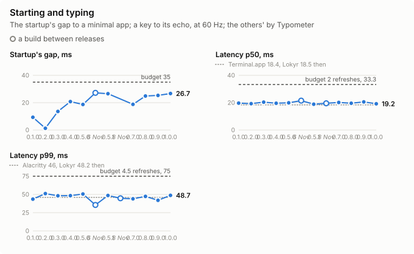
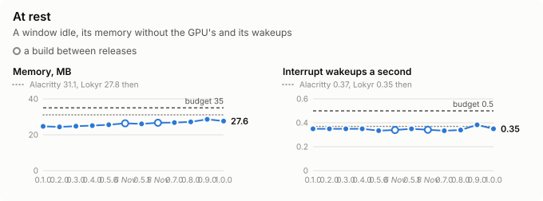
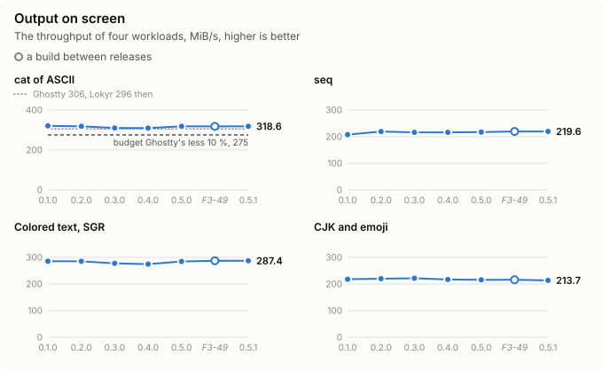
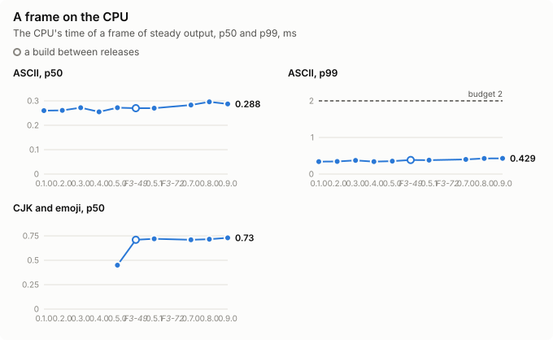
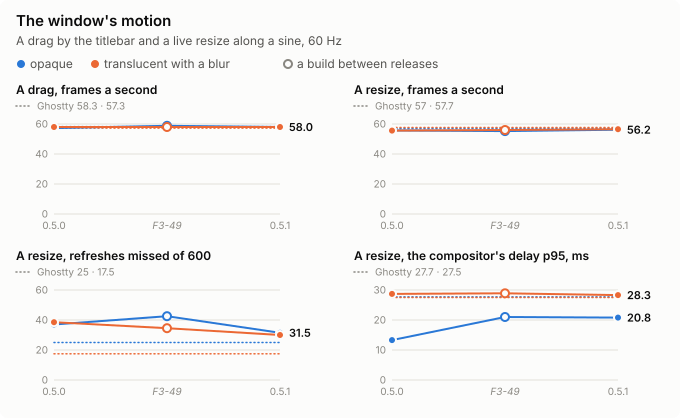

# The releases' benchmarks side by side

Every release's measures, at a glance and in one table, and the build under way, each column of the A/B that measured it against the release before, at F2-134's conditions: Menlo at 13 points, 120 × 40 cells, an opaque window, the main display at 60 Hz. Each release's notes tell the features that it brought and what they cost, as its session found. Each release's session adds its column and its notes here, the window's motion among its measures, as the user asked on 6 November 2026, and its values to [releases.json](releases.json), the data of the summary and the charts below, which `just release-charts` draws again.

Measures of different sessions compare within a few percent alone: a session's load and display move them, as each report tells; the A/B of a release against the one before, in one session of balanced orders, is what tells a cost. The window's motion, a drag by the titlebar and a live resize along a sine of 200 points, is measured as [F3-152](motion-F3-152.md) measures it, of its config, Menlo at 20 points, 88 × 27 cells.

<!-- The summary and the charts, which tools/bench/releases.py writes from releases.json: edit those, not this. -->

## At a glance

0.5.1 against 0.5.0, both measured in 0.5.1's session, [ab-F3-190](ab-F3-190.md): each measure's change, the share of its budget, and whether it is as before, better, or worse beyond its rounds' spread.

| Measure | 0.5.0 | 0.5.1 | Change | Budget | |
|---|---|---|---|---|---|
| Startup, its gap to the minimal app's first window | 13.4 ms | 26.6 ms | +13.2 ms, +99 % | ≤ 35 ms, 76 % of it | ⚠️ Worse, within its budget |
| Latency, a key to its echo, p50 | 18.9 ms | 18.9 ms | ±0.0 ms, ±0 % | — | ✅ As before |
| Latency, a key to its echo, p99 | 46.6 ms | 48.6 ms | +2.0 ms, +4 % | — | ✅ As before |
| Memory at rest, without the GPU's | 25.7 MB | 26.1 MB | +0.5 MB, +2 % | ≤ 35 MB, 75 % of it | ✅ As before |
| Idle, interrupt wakeups | 0.35/s | 0.35/s | ±0.00/s, ±0 % | ≤ 0.5/s, 70 % of it | ✅ As before |
| Idle, package idle wakeups | 0.00/s | 0.00/s | ±0.00/s | ≤ 0/s | ✅ As before |
| `cat` of 1 GiB of ASCII on screen | 330.0 MiB/s | 318.6 MiB/s | −11.4 MiB/s, −3 % | — | ✅ As before |
| `seq 1 10000000` | 218.9 MiB/s | 219.6 MiB/s | +0.7 MiB/s, +0 % | — | ✅ As before |
| Colored text, SGR | 290.5 MiB/s | 287.4 MiB/s | −3.1 MiB/s, −1 % | — | ✅ As before |
| CJK and emoji | 218.2 MiB/s | 213.7 MiB/s | −4.5 MiB/s, −2 % | — | ✅ As before |
| A frame on the CPU, ASCII, p50 | 0.270 ms | 0.270 ms | +0.001 ms, +0 % | — | ✅ As before |
| A frame on the CPU, CJK and emoji, p50 | 0.44 ms | 0.72 ms | +0.28 ms, +63 % | — | ⚠️ Worse |
| A drag of the window, opaque, frames a second | 57.4/s | 58.0/s | +0.6/s, +1 % | — | ✅ As before |
| A drag of the window, translucent with a blur, frames a second | 57.2/s | 58.0/s | +0.8/s, +1 % | — | ✅ As before |
| A live resize, opaque, frames a second | 55.8/s | 56.2/s | +0.4/s, +1 % | — | ✅ As before |
| A live resize, translucent with a blur, frames a second | 56.2/s | 56.5/s | +0.3/s, +1 % | — | ✅ As before |
| A live resize, opaque, refreshes missed of 600 | 36.5 | 31.5 | −5.0, −14 % | — | ✅ As before |
| A live resize, translucent with a blur, refreshes missed of 600 | 32.0 | 30.0 | −2.0, −6 % | — | ✅ As before |
| A live resize, opaque, the compositor's delay, p95 | 14.3 ms | 20.8 ms | +6.5 ms, +45 % | — | ⚠️ Worse |
| A live resize, translucent with a blur, the compositor's delay, p95 | 13.0 ms | 28.3 ms | +15.3 ms, +118 % | — | ⚠️ Worse |

The latency's budgets, 2 refreshes at the p50 and 4.5 at the p99, are of a display at 120 Hz, which these sessions at 60 Hz do not measure.

## Over the releases

Each measure over the releases, a dot of each release and a ring of a build between two, its budget a dashed line, of the columns of [the table](#every-measure): different sessions, which compare within a few percent alone.

<!-- The end of what tools/bench/releases.py writes. -->

## Every measure

| Measure | F2, 0.1.0 | 0.2.0 | 0.3.0 | 0.4.0 | 0.5.0 | After F3-49 | 0.5.1 | Budget |
|---|---|---|---|---|---|---|---|---|
| Report | [ab-F3-13](ab-F3-13.md) | [ab-F3-13](ab-F3-13.md) | [ab-F3-83](ab-F3-83.md) | [ab-F3-29](ab-F3-29.md) | [ab-F3-40](ab-F3-40.md) | [ab-F3-49](ab-F3-49.md) | [ab-F3-190](ab-F3-190.md) | |
| Startup, warm, first frame, median | 236.2, 234.8 ms | 220.1, 234.8 ms | 239.9, 237.1 ms | 230.3, 236.4 ms | 237.7, 236.9, 237.6, 238.1 ms | 236.7, 234.2, 239.8, 233.1 ms | 235.8, 234.8, 234.9, 235.8 ms | |
| Its gap to the minimal app's first window | 8.6, 10.1 ms | −7.5, 10.1 ms | 13.5, 13.7 ms | 19.0, 22.6 ms | 18.7 ms | 27.2 ms | 26.6 ms | ≤ 35 ms |
| Latency, p50 | 19.7 ms | 19.3 ms | 20.4 ms | 19.6 ms | 19.9 ms | 21.5 ms | 18.9 ms | ≤ 2 frames at 120 Hz |
| Latency, p99 | 43.6 ms | 51.2 ms | 48.2 ms | 48.3 ms | 50.6 ms | 35.6 ms | 48.6 ms | ≤ 4.5 frames at 120 Hz |
| Its samples in the fourth refresh or later | | | | 10 of 1592 | 25 of 3184 | 0 of 1592 | 11 of 1592 | |
| Idle, package idle wakeups | 0/s | 0/s | 0, 0.02/s | 0/s | 0.017, 0/s | 0/s | 0/s | 0/s |
| Idle, interrupt wakeups | 0.35/s | 0.35/s | 0.35/s | 0.35/s | 0.32, 0.35/s | 0.33, 0.35/s | 0.35/s | ≤ 0.5/s |
| Footprint without the GPU's, at rest | 24.7 MB | 24.4 MB | 24.8 MB | 25.1 MB | 25.6 MB | 26.4 MB | 26.1 MB | ≤ 35 MB |
| GPU memory | 30.0 MB | 30.0 MB | 30.0 MB | 14.1 MB, of a scale of 1 | 30.5 MB | 30.5 MB | 30.3 MB | |
| `cat` of 1 GiB of ASCII on screen | 321.0 MiB/s | 318.8 MiB/s | 310.1 MiB/s | 309.7 MiB/s | 318.7 MiB/s | 318.4 MiB/s | 318.6 MiB/s | |
| `seq 1 10000000` | 207.6 MiB/s | 219.2 MiB/s | 216.3 MiB/s | 216.5 MiB/s | 217.2 MiB/s | 219.8 MiB/s | 219.6 MiB/s | |
| Colored text, SGR | 285.7 MiB/s | 285.5 MiB/s | 277.7 MiB/s | 274.7 MiB/s | 284.5 MiB/s | 287.2 MiB/s | 287.4 MiB/s | |
| CJK and emoji | 218.1 MiB/s | 220.0 MiB/s | 221.7 MiB/s | 217.1 MiB/s | 215.7 MiB/s | 216.1 MiB/s | 213.7 MiB/s | |
| A frame on the CPU, ASCII, p50 | 0.260 ms | 0.261 ms | 0.272 ms | 0.255 ms, of a scale of 1 | 0.272 ms | 0.270 ms | 0.270 ms | p99 ≤ 2 ms |
| A frame on the CPU, CJK and emoji, p50 | | | | | 0.45 ms | 0.71 ms | 0.72 ms | |
| A drag of the window, frames a second shown, opaque and translucent with a blur | | | | | 57.3, 58.0 | 58.8, 58.0 | 58.0, 58.0 | |
| Its refreshes missed of 600 | | | | | 15.0, 16.5 | 9.0, 16.0 | 15.5, 16.5 | |
| A live resize, frames a second shown, opaque and translucent with a blur | | | | | 55.7, 55.6 | 55.3, 56.0 | 56.2, 56.5 | |
| Its refreshes missed of 600 | | | | | 37.0, 38.5 | 42.5, 34.5 | 31.5, 30.0 | |
| A live resize, the window server's CPU and the app's | | | | | 33 % and 18 %, 36 % and 18 % | 34 % and 19 %, 36 % and 17 % | 36 % and 18 %, 37 % and 18 % | |
| A live resize, the compositor's delay at the 95th percentile, opaque and a blur | | | | | 13.3, 28.7 ms | 21.0, 28.9 ms | 20.8, 28.3 ms | |

The window's motion was first measured of 0.5.0 and the build after F3-49, in the [motion session after F3-49](ab-F3-49.md#the-windows-motion), of the means of two rounds; F3-152 measured it of the builds before 0.5.0, against Ghostty's. The latency's p50 and p99 are the means of the session's rounds: F2's and 0.2.0's of the first two rounds of F3-13, 0.3.0's of F3-83's two, 0.4.0's of F3-29's eight, 0.5.0's of F3-40's sixteen, the build after F3-49's of its eight, 0.5.1's of F3-190's eight. In F3-190's session, 0.5.0 measured 18.9 ms at the p50 and 46.6 ms at the p99, 9 samples in the fourth refresh or later, a startup's gap of 13.4 ms, 25.7 MB at rest, of the sessions' 25.6 and 25.7, 330.0 MiB/s of `cat` and a CJK frame of 0.44 ms, against which 0.5.1 is read; its motion, 57.4 and 57.2 frames a second of a drag, 55.8 and 56.2 of a resize, as 0.5.1's. In the session after F3-49, 0.5.0 measured 19.0 ms at the p50 and 47.8 ms at the p99, 10 samples in the fourth refresh or later, and a startup's gap of 21.9 ms, against which the build after F3-49 is read below.

## The releases' features and their costs

- **F2, 0.1.0**: the macOS app of a single pane, of the headless VT core of F1: the baseline.
- **0.2.0**, F3's architecture: the controller in `app-core`, the kernel's workspace, the plugins' first plumbing. No measure moved beyond its spread.
- **0.3.0**, the distribution: Sparkle's updater, the DMG, the notarization. The startup took a refresh more, the work before the first frame a few milliseconds longer; Sparkle at rest no wakeup and under 0.5 MB.
- **0.4.0**, `ui-core`: the view tree, its layout and paint, the widgets, AccessKit's tree for VoiceOver. The startup took a refresh less; the latency's tail a few samples longer, 10 of 1592 in the fourth refresh against 4; the footprint 0.4 MB larger, of a binary 0.42 MB larger.
- **0.5.0**, the plumbing: the workspace in the HostApi, the slots and the panels in the windows, the plugins on threads of their own, their config and state. The latency's p99 3.6 ms longer, within its budget, a few samples; the startup a refresh more now and then, of the slots in the windows; the footprint 0.4 MB larger, of a binary 0.98 MB larger.
- **After F3-49**, the plugins' block under way for 0.6.0: the keymap's plugin, the tab bar, its drags out to windows and into panes, its marks, its spinner and a single tab's title in the titlebar; the splits' commands, dividers, padding, fade, headers and the keyboard that follows the pointer; the window server's progresses. Against 0.5.0 of the same session: the latency's p50 2.4 ms longer and its tail shorter, of no sample in the fourth refresh; the startup 5 ms longer, its gap 27 ms; the footprint 0.9 MB larger; a frame of CJK and emoji 0.26 ms longer on the CPU, of the same throughput; the window's drag and live resize as 0.5.0's. **The single tab's title** that the tabs plugin draws costs a refresh at the start, 233 ms against 216 without the plugin, and 2.7 ms of the latency's median, and a frame at each title's change, 102 of 100 changes against one; a program's progress draws no frame of its own, the window server sliding its fills. **[F3-187](ab-F3-49.md#the-starts-cause-and-its-fix-and-the-latency-again-f3-187)** found the start's refresh a second frame of the title's view, of a tab's label that changed within the first frame, as the window showed, and fixed it: the start of 233.8 ms against 245.7 before the fix and 235.8 without the plugin, the window on screen 23 ms sooner; the latency's difference did not repeat in its session, the median 23.8 ms of the plugin against 26.7 without it and the p99 42 ms against 72. The frame at each title's change stays.
- **0.5.1**, the plugins' block so far, released before the themes: the keymap's plugin, the tab bar with its drags, marks and looks, the splits, the windows' numbers, quitting with the last window, and the find bar with its highlights. Against 0.5.0 in [F3-190's session](ab-F3-190.md), every budget holds: the latency, idle, the memory and the throughput are 0.5.0's within their spread, the footprint 0.5 MB larger. **The startup is 13 ms longer** in each of four rounds, its gap to the minimal app 26.6 ms against 13.4, within the budget of 35, the plugins' block's start ([B-445](../tasks/BACKLOG.md)). **A frame of CJK and emoji takes 0.27 ms more on the CPU**, and the p99 of the colored workloads' frames 1 to 2.5 ms more, of the same throughput, as after F3-49 ([B-504](../tasks/BACKLOG.md)). **A live resize** shows as many frames, of fewer missed refreshes, and one frame in twenty may come a refresh later, the compositor's delay at the 95th percentile 28 ms in three of four resizes against 13 to 15 in each of 0.5.0's of the session, though 0.5.0 showed 28 ms in two of four in the session after F3-49 ([B-503](../tasks/BACKLOG.md)); the drags are 0.5.0's.
