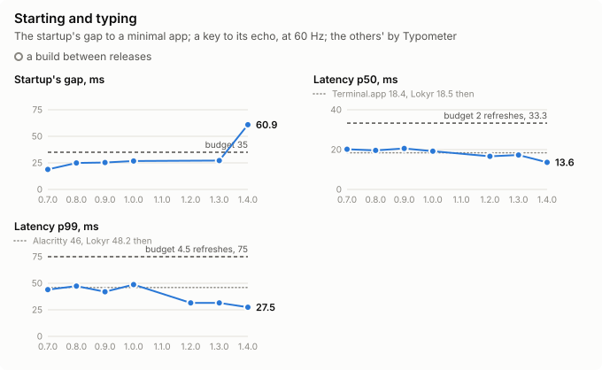
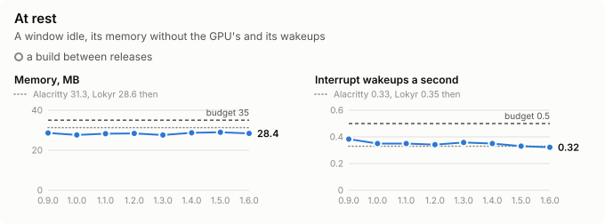

# The releases' benchmarks side by side

The last eight releases' measures, at a glance and in one table, each column of the A/B that measured it against the release before, at the conditions of [compare-F2-134](compare-F2-134.md): Menlo at 13 points, 120 × 40 cells, an opaque window, the main display at 60 Hz. Each release's notes tell the features that it brought and what they cost, as its session found. Each release's session adds its values, the window's motion among them, and its cells of the table of every measure with their notes, to [releases.json](releases.json), the data of the summary, the charts and the table below, which `just release-charts` draws again, and its features and their costs here; and takes the oldest release's away, which that release's own report keeps.

From 1.1.0 the sessions run of [a config of the least work](ab-F3b-20/config.toml) beside the terminal's own, no blinking nor ligatures, an opaque window, no quick tip, the same for every release from there, and 1.1.0's of the built-in display at 120 Hz: its column tells its latency, throughput and startup against 1.0.0's of its session, and the summary and the charts take its measures at rest alone, which neither the config nor the display moves. 1.2.0's session is of the display at 60 Hz again, of that config: its latency and its throughput join the charts, of a config that does less than the one before 1.1.0, as no blinking, which the releases before do not share; the startup's gap stays out of them, of a minimal app some 15 to 30 ms faster in the sessions from 1.1.0 on than before. 1.3.0's session is of a Dell U3417W at 60 Hz and a scale of 1, which halves the GPU's memory of both versions and takes away some of a live resize's missed refreshes, 1.2.0's 20 and 15 there against 33 and 31 in its own session; its minimal app started in 207 to 218 ms, as in the sessions before 1.1.0's, and its startup's gap joins the charts again. 1.4.0's session is of a Dell P2721Q at 60 Hz and a scale of 2, as 1.2.0's; its minimal app started in 170 to 195 ms, 15 to 40 ms quicker than before, which took the startup's gap of both versions past its budget, and its output on screen was slower for both, `cat` 266 and 270 MiB/s against 315 for both on that display in 1.2.0's session. [The startup and the output at rest](rest-F5a-123.md) took them again, and its values are the summary's, the charts' and the table's: its minimal app started in 217 to 230 ms, 1.3.0's notarized app's gap 30.7 ms, as a copy not notarized started 12.5 ms later in that session; 1.4.0's startup is of [its release's DMG against 1.3.0's](startup-F5a-79.md), both notarized.

1.5.0's session is of [ttybench](https://github.com/sephiroth74/ttybench), the toolkit that measures any terminal alike, [ab-F5b-20](ab-F5b-20.md): 1.4.0's tag of a bundle against 1.5's bundle, signed alike and neither notarized, on a 5K display at 60 Hz and a scale of 2 from its latency on. Its latency is of ttybench's capture of the window and of keys at every phase of the refresh, its wakeups at rest the mean of intervals of a second 20 s after the launch, its throughput to the quiet of a window of 120 × 40 cells, its window's motion of that window, which tell other figures than the releases' before of their tools: 1.4.0's values of that session are its column's notes, which the summary compares 1.5.0 with, and the trends between 1.4.0's column and 1.5.0's mix the two methods. The startup and its gap to the minimal app are of [the releases' notarized DMGs](startup-F5b-21.md), as 1.4.0's, whose gap was past its budget for both versions there, 1.4.0's DMG's 20.8 ms of 22 November 54.6 in that session, a gap that [a later session](startup-F5b-45.md) found within its budget after a restart and past it again within the same session, as the minimal app's launch moved of the Mac's state, Lokyr's first frame falling on the display's refreshes and the minimal app's window not; the memory without the GPU's and a frame on the CPU are of `lokyr-bench`, as before; the translucent window's motion and the scroll's CPU were not measured.

Measures of different sessions compare within a few percent alone: a session's load and display move them, as each report tells; the A/B of a release against the one before, in one session of balanced orders, is what tells a cost. The window's motion, a drag by the titlebar and a live resize along a sine of 200 points, is measured as [motion-F3-152](motion-F3-152.md) measures it, of its config, Menlo at 20 points, 88 × 27 cells.

<!-- The summary and the charts, which tools/bench/releases.py writes from releases.json: edit those, not this. -->

## At a glance

1.5.0 against 1.4.0, both measured in 1.5.0's session, [ab-F5b-20](ab-F5b-20.md), but a measure that names another: each measure's change, the share of its budget, the best of the other terminals, of [the comparison of 21 and 22 November 2026](compare-F5a-78.md) and [the window's motion](motion-F3-152.md), with Lokyr's own value of that session where its conditions differ, and whether it is as before, better, or worse beyond its rounds' spread.

| Measure | 1.4.0 | 1.5.0 | Change | Budget | The best of the others | |
|---|---|---|---|---|---|---|
| Startup, its gap to the minimal app's first window, of [the startup of the releases' notarized DMGs](startup-F5b-21.md)'s session | 54.6 ms | 55.0 ms | +0.4 ms, +1 % | ≤ 35 ms, 157 % of it | — | ❌ Over its budget |
| Latency, a key to its echo, p50 | 16.8 ms | 16.3 ms | −0.5 ms, −3 % | ≤ 33.3 ms, 49 % of it | Alacritty 23.6, Lokyr 22.4 then | ✔ As before |
| Latency, a key to its echo, p99 | 31.2 ms | 28.0 ms | −3.2 ms, −10 % | ≤ 75 ms, 37 % of it | kitty 33.1, Lokyr 29.5 then | ✔ As before |
| Memory at rest, without the GPU's | 29.0 MB | 29.0 MB | +0.1 MB, +0 % | ≤ 35 MB, 83 % of it | Alacritty 31.3, Lokyr 28.6 then | ✔ As before |
| Idle, interrupt wakeups | 0.35/s | 0.33/s | −0.02/s, −5 % | ≤ 0.5/s, 66 % of it | Alacritty 0.33, Lokyr 0.35 then | ✔ As before |
| Idle, package idle wakeups | 0.00/s | 0.00/s | ±0.00/s | ≤ 0/s | — | ✔ As before |
| `cat` of 1 GiB of ASCII on screen | 313.0 MiB/s | 313.9 MiB/s | +0.9 MiB/s, +0 % | ≥ 275 MiB/s | Ghostty 305.5, Lokyr 293.5 then | ✔ As before |
| Colored text, SGR | 282.5 MiB/s | 282.0 MiB/s | −0.5 MiB/s, −0 % | — | — | ✔ As before |
| CJK and emoji | 330.3 MiB/s | 330.3 MiB/s | −0.1 MiB/s, −0 % | — | — | ✔ As before |
| A frame on the CPU, ASCII, p50 | 0.361 ms | 0.360 ms | −0.001 ms, −0 % | — | — | ✔ As before |
| A frame on the CPU, ASCII, p99 | 0.451 ms | 0.453 ms | +0.003 ms, +1 % | ≤ 2 ms, 23 % of it | — | ✔ As before |
| A frame on the CPU, CJK and emoji, p50 | 0.79 ms | 0.78 ms | −0.02 ms, −2 % | — | — | ✔ As before |
| A drag of the window, opaque, frames a second | 57.9/s | 58.1/s | +0.3/s, +0 % | — | Ghostty 58.3 | ✔ As before |
| A live resize, opaque, frames a second | 58.8/s | 58.8/s | −0.0/s, −0 % | — | Ghostty 57 | ✔ As before |
| A live resize, opaque, refreshes missed of 600 | 11.0 | 11.0 | ±0.0, ±0 % | — | Ghostty 25 | ✔ As before |
| A live resize, opaque, the compositor's delay, p95 | 26.5 ms | 27.9 ms | +1.4 ms, +5 % | — | Ghostty 27.7 | ✔ As before |

The latency's budgets, 2 refreshes at the p50 and 4.5 at the p99, set of a display at 120 Hz, are of these sessions' 60 Hz here: 33.3 and 75 ms. The throughput's of `cat` is the faster of Ghostty and Alacritty less 10 %, of [the comparison of 21 and 22 November 2026](compare-F5a-78.md): Ghostty's 305.5 MiB/s.

## Over the releases

Each measure over the last eight releases, a dot of each release, its budget a dashed line, and the best of the other terminals a dotted one, of [the comparison of 21 and 22 November 2026](compare-F5a-78.md), and of [the window's motion](motion-F3-152.md) for the window's motion, measured once of their versions then, Lokyr's own value of that session beside it where its conditions differ from the releases' sessions, the latency's by Typometer, of the screen; of the columns of [the table](#every-measure): different sessions, which compare within a few percent alone. A panel without a dashed line has no budget, as `seq`'s, SGR's, CJK's and the window's motion; without a dotted one, no other terminal was measured of it: that comparison timed no minimal app beside the others' first windows, which their startup's gap needs, nor the four workloads but `cat`, nor a frame's CPU.

<!-- The end of what tools/bench/releases.py writes. -->

## Every measure

<!-- The table of every measure, which tools/bench/releases.py writes from releases.json's `table`: edit that, not this. -->

Each release's measures in its own session: ▲ better and ▼ worse than the release before, as that session measured both, beyond the rounds' spread; ✖ past the budget; — not measured; the numbers, the notes under the table.

| Measure | Budget | [0.8.0](ab-F4-25.md) | [0.9.0](ab-F4-42.md) | [1.0.0](ab-F3-85.md) | [1.1.0](ab-F3b-20.md) | [1.2.0](ab-F3b-29.md) | [1.3.0](ab-F5a-17.md) | [1.4.0](ab-F5a-78.md) | [1.5.0](ab-F5b-20.md) |
|---|---|---:|---:|---:|---:|---:|---:|---:|---:|
| **Startup** | | | | | | | | | |
| Startup, warm, first frame, ms |  | 241.1 ¹ | 248.5 ² | 237.3 ³ | 245.6 ⁴ | 254.3 ⁵ | 238.6 ⁶ | 249.2 ⁷ | 268.2 ⁸ |
| Its gap to the minimal app's first window, ms | ≤ 35 | 24.9 ▼ ⁹ | 25.4 ¹⁰ | 26.7 ¹¹ | 52.2 ✖ ¹² | 58.5 ✖ ¹³ | 27.2 ¹⁴ | 20.8 ¹⁵ | 55.0 ✖ ¹⁶ |
| **Latency** | | | | | | | | | |
| A key to its echo, p50, ms | ≤ 33.3 ¹⁷ | 19.6 | 20.6 | 19.2 | 13.9 ¹⁸ | 16.6 ▲ | 17.3 | 13.6 | 16.3 ¹⁹ |
| A key to its echo, p99, ms | ≤ 75 ²⁰ | 47.3 | 42.0 | 48.7 | 32.0 ¹⁸ | 31.5 | 31.5 | 27.5 | 28.0 ²¹ |
| Its samples in the fourth refresh or later |  | 10 of 1592 | 3 of 1592 | 11 of 1592 | 46 of 1592 ¹⁸ | 0 of 1591 | 0 of 1592 | 0 of 1592 | — |
| **At rest** | | | | | | | | | |
| Package idle wakeups, a second | 0 | 0 | 0 | 0 | 0 | 0 | 0 ²² | 0 | 0 ²³ |
| Interrupt wakeups, a second | ≤ 0.5 | 0.34 | 0.38 | 0.35 | 0.35 | 0.34 | 0.36 | 0.35 | 0.33 ²⁴ |
| Footprint without the GPU's, MB | ≤ 35 | 27.2 ▲ | 28.6 ²⁵ | 27.6 | 28.3 | 28.4 ²⁶ | 27.6 ²⁷ | 28.7 ²⁸ | 29.0 ²⁹ |
| GPU memory, MB |  | 30.1 | 30.1 | 30.1 | 30.6 | 30.6 | 14.2 ³⁰ | 30.6 ³¹ | 30.6 ³² |
| **Output on screen** | | | | | | | | | |
| `cat` of 1 GiB of ASCII, MiB/s | ≥ 275.0 ³³ | 315.0 | 311.9 | 310.9 | 271.1 ✖ ¹⁸ | 314.9 | 308.6 | 304.4 ³⁴ | 313.9 ³⁵ |
| `seq 1 10000000`, MiB/s |  | 222.1 | 223.8 | 220.9 | 192.6 ¹⁸ | 217.9 | 218.3 | 216.8 ³⁶ | 208.9 ³⁷ |
| Colored text, SGR, MiB/s |  | 285.6 | 288.9 | 284.7 | 234.7 ¹⁸ | 286.3 | 285.2 | 281.1 ³⁸ | 282.0 ³⁹ |
| CJK and emoji, MiB/s |  | 215.3 | 216.5 | 214.9 | 207.8 ¹⁸ | 214.9 | 213.2 | 216.1 ⁴⁰ | 330.3 ⁴¹ |
| **A frame on the CPU** | | | | | | | | | |
| ASCII, p50, ms |  | 0.296 | 0.288 | 0.282 | 0.385 ¹⁸ | 0.298 | 0.277 | 0.323 | 0.360 ⁴² |
| ASCII, p99, ms | ≤ 2 | 0.427 | 0.429 | 0.403 | 0.463 ¹⁸ | 0.423 | 0.418 | 0.445 | 0.453 ⁴³ |
| CJK and emoji, p50, ms |  | 0.72 | 0.73 | 0.73 | 0.79 ¹⁸ | 0.78 | 0.73 | 0.68 | 0.777 ⁴⁴ |
| **The window's motion** | | | | | | | | | |
| A drag, opaque, frames a second |  | — ⁴⁵ | — ⁴⁶ | — ⁴⁷ | 57.7 ⁴⁸ | 57.1 | 58.3 ⁴⁹ | 58.4 ⁵⁰ | 58.1 ⁵¹ |
| A drag, with a blur, frames a second |  | — | — | — | 58.1 | 58.0 | 58.5 | 58.7 ▲ | — |
| A drag, opaque, refreshes missed of 600 |  | — | — | — | 16.0 | 23.0 | 7.5 | 11.5 | 17.5 ⁵² |
| A drag, with a blur, refreshes missed of 600 |  | — | — | — | 15.0 | 16.0 | 9.0 | 9.5 | — |
| A live resize, opaque, frames a second |  | — | — | — | 56.2 | 55.7 | 57.4 | 55.5 | 58.8 ⁵³ |
| A live resize, with a blur, frames a second |  | — | — | — | 55.8 | 56.3 | 57.6 | 56.8 | — |
| A live resize, opaque, refreshes missed of 600 |  | — | — | — | 31.5 | 33.0 | 15.0 ⁵⁴ | 36.0 ⁵⁵ | 11 ⁵⁶ |
| A live resize, with a blur, refreshes missed of 600 |  | — | — | — | 36.5 | 31.0 | 13.7 | 23.5 | — |
| A live resize, opaque, the window server's CPU, % |  | — | — | — | 35 | 34 | 35 | 35 | 44 ⁵⁷ |
| A live resize, opaque, the app's CPU, % |  | — | — | — | 16 | 16 | 15 | 17 | 31 ⁵⁸ |
| A live resize, with a blur, the window server's CPU, % |  | — | — | — | 31 | 34 | 38 | 37 | — |
| A live resize, with a blur, the app's CPU, % |  | — | — | — | 15 | 15 | 15 | 16 | — |
| A live resize, opaque, the compositor's delay, p95, ms |  | — | — | — | 20.6 | 28.3 ⁵⁹ | 21.0 ⁶⁰ | 13.4 | 27.9 ⁶¹ |
| A live resize, with a blur, the compositor's delay, p95, ms |  | — | — | — | 20.8 | 19.8 | 18.4 | 28.4 ⁶² | — |
| **Scrolling by pixels** | | | | | | | | | |
| A trackpad's scroll, the app's frames a second, at 60 Hz |  | — | — | — | — | — | — | 60.8 ⁶³ | 60.7 ⁶⁴ |
| Its refreshes with a frame, % |  | — | — | — | — | — | — | 99 | 99.2 ⁶⁵ |
| Its app's CPU, % |  | — | — | — | — | — | — | 6.9 ⁶⁶ | — |
| Package idle wakeups after it, a second |  | — | — | — | — | — | — | 0 | — |
| The same at 120 Hz, the app's frames a second |  | — | — | — | — | — | — | 123.3 ⁶⁷ | — |
| Its refreshes with a frame at 120 Hz, % |  | — | — | — | — | — | — | 98.6 | — |
| Its app's CPU at 120 Hz, % |  | — | — | — | — | — | — | 10.7 ⁶⁸ | — |

Notes:

1. 0.8.0 · Startup, warm, first frame, ms: the median of four rounds, 250.8, 248.4, 233.8 and 232.9.
2. 0.9.0 · Startup, warm, first frame, ms: the median of four rounds, 251.4, 249.8, 247.1 and 247.2.
3. 1.0.0 · Startup, warm, first frame, ms: the median of four rounds, 222.3, 240.5, 241.3 and 234.0.
4. 1.1.0 · Startup, warm, first frame, ms: the mean of eight rounds of copies started as often as 1.0.0's, 242.9; a new copy's four rounds 245.5, 243.8, 252.2 and 246.8.
5. 1.2.0 · Startup, warm, first frame, ms: the mean of eight rounds of copies started as often as 1.1.0's, 248.9; a new copy's four rounds 254.1, 262.8, 237.3 and 252.3.
6. 1.3.0 · Startup, warm, first frame, ms: the mean of eight rounds of copies started 60 times, 1.2.0's 240.0; four rounds of copies started 30 times 239.3, 270.6, 263.2 and 284.4.
7. 1.4.0 · Startup, warm, first frame, ms: the mean of twelve rounds of the release's DMG, notarized, 1.3.0's DMG 250.1 in the same session, [startup-F5a-79](startup-F5a-79.md#results); 240.5 in the A/B and 267.2 at rest, of a bundle not notarized.
8. 1.5.0 · Startup, warm, first frame, ms: the mean of twelve rounds of the release's DMG, notarized, 1.4.0's DMG 267.8 in the same session, [startup-F5b-21](startup-F5b-21.md#results); 253.1 of bundles not notarized in the A/B, 1.4.0's tag 250.2, [ab-F5b-20](ab-F5b-20.md#the-measures-of-lokyr-bench).
9. 0.8.0 · Its gap to the minimal app's first window, ms: of a new copy started once before; 20.4 ms at rest against 0.7.0's 26.9, within the rounds' spread, [rest-F4-58](rest-F4-58.md#the-startup-at-rest).
10. 0.9.0 · Its gap to the minimal app's first window, ms: of a copy new out of its build started once before, against 0.8.0's 23.8 in the session.
11. 1.0.0 · Its gap to the minimal app's first window, ms: of a copy new out of its DMG started once before, against 0.9.0's 28.9 in the session.
12. 1.1.0 · Its gap to the minimal app's first window, ms: of a new copy against 1.0.0's 42.5 in the session, of a minimal app 15 ms faster than before; the startup 2.7 ms longer than 1.0.0's of copies started as often, [ab-F3b-20](ab-F3b-20.md#the-startup).
13. 1.2.0 · Its gap to the minimal app's first window, ms: of eight rounds against 1.1.0's 53.2, of a minimal app of 179 to 210 ms; the startup 5.3 ms longer, within the rounds' spread, [ab-F3b-29](ab-F3b-29.md#results).
14. 1.3.0 · Its gap to the minimal app's first window, ms: of eight rounds against 1.2.0's 28.6, of a minimal app of 207 to 218 ms, as before 1.1.0's sessions.
15. 1.4.0 · Its gap to the minimal app's first window, ms: of twelve rounds of the releases' notarized DMGs, 1.3.0's 21.7, of a minimal app of 222 to 243 ms, [startup-F5a-79](startup-F5a-79.md#results); 60.9 in the A/B and 43.5 at rest, of a bundle not notarized.
16. 1.5.0 · Its gap to the minimal app's first window, ms: of twelve rounds of the releases' notarized DMGs, 1.4.0's 54.6 in the same session, past the budget for both, of a minimal app of 209 to 216 ms, while 1.4.0's DMG had 20.8 on 22 November, [startup-F5b-21](startup-F5b-21.md#results); 34.6 at rest of bundles not notarized, 1.4.0's 34.9, and 47.8 in the A/B, [ab-F5b-20](ab-F5b-20.md#the-measures-of-lokyr-bench); after a restart, 28.3 ms, then 51.5 within the same session as the minimal app's launch moved, of no change to the copies, [startup-F5b-45](startup-F5b-45.md#why-the-gap-moves).
17. The budget · A key to its echo, p50, ms: 2 refreshes at 60 Hz, as the budget of 2 at 120 Hz.
18. 1.1.0: of its session on the built-in display at 120 Hz, of the config of the least work, against 1.0.0's of the same session.
19. 1.5.0 · A key to its echo, p50, ms: of ttybench, its capture of the window and its keys at every phase of the refresh, eight runs of 100 keys, on a 5K display at 60 Hz; 1.4.0's 16.8 in the same session.
20. The budget · A key to its echo, p99, ms: 4.5 refreshes at 60 Hz, as the budget of 4.5 at 120 Hz.
21. 1.5.0 · A key to its echo, p99, ms: of ttybench; 1.4.0's 31.2 in the same session.
22. 1.3.0 · Package idle wakeups, a second: over 240 s, two rounds; 0.017 in two of four rounds of 60 s, of the same interrupt wakeups as 1.2.0's, [ab-F5a-17](ab-F5a-17.md#results).
23. 1.5.0 · Package idle wakeups, a second: of ttybench, 30 s of each copy 20 s after its launch, in four cycles; 1.4.0's 0.
24. 1.5.0 · Interrupt wakeups, a second: of ttybench, the mean of its intervals of a second; 1.4.0's 0.35 in the same session.
25. 0.9.0 · Footprint without the GPU's, MB: the mean of two rounds, 30.4 and 26.9.
26. 1.2.0 · Footprint without the GPU's, MB: the mean of four rounds.
27. 1.3.0 · Footprint without the GPU's, MB: the median of four rounds, one of 31.5.
28. 1.4.0 · Footprint without the GPU's, MB: the median of four rounds.
29. 1.5.0 · Footprint without the GPU's, MB: the median of four rounds of `lokyr-bench`, 1.4.0's 28.9 in the same session.
30. 1.3.0 · GPU memory, MB: of a display at a scale of 1, as 1.2.0's in the same session.
31. 1.4.0 · GPU memory, MB: of a display at a scale of 2, as 1.3.0's in the same session.
32. 1.5.0 · GPU memory, MB: of a display at a scale of 2, as 1.4.0's in the same session.
33. The budget · `cat` of 1 GiB of ASCII, MiB/s: Ghostty's 305.5 MiB/s of the comparison of 21 and 22 November 2026 less 10 %; 294.9 of the comparison of 13 November 2026 before, 275 of the first comparison's before that.
34. 1.4.0 · `cat` of 1 GiB of ASCII, MiB/s: at rest, 1.3.0's 303.7 in the same session, [rest-F5a-123](rest-F5a-123.md#results); 269.5 in the A/B, of a session's slower output for both.
35. 1.5.0 · `cat` of 1 GiB of ASCII, MiB/s: of ttybench, to the quiet, a window of 120 × 40 cells, 1.4.0's 313.0 in the same session; 270.4 against 277.1 of `lokyr-bench` in a window of 1920 × 1080.
36. 1.4.0 · `seq 1 10000000`, MiB/s: at rest, 1.3.0's 218.4, [rest-F5a-123](rest-F5a-123.md#results); 185.9 in the A/B.
37. 1.5.0 · `seq 1 10000000`, MiB/s: of `lokyr-bench`, of runs of 147 to 231, 1.4.0's 185.8 in the same session.
38. 1.4.0 · Colored text, SGR, MiB/s: at rest, 1.3.0's 271.8, [rest-F5a-123](rest-F5a-123.md#results); 191.9 in the A/B.
39. 1.5.0 · Colored text, SGR, MiB/s: of ttybench's colored text, 1.4.0's 282.5 in the same session.
40. 1.4.0 · CJK and emoji, MiB/s: at rest, 1.3.0's 217.2, [rest-F5a-123](rest-F5a-123.md#results); 204.6 in the A/B.
41. 1.5.0 · CJK and emoji, MiB/s: of ttybench's wide characters, two cells each, 1.4.0's 330.3 in the same session.
42. 1.5.0 · ASCII, p50, ms: the mean of two rounds of `lokyr-bench`, 1.4.0's 0.361.
43. 1.5.0 · ASCII, p99, ms: 1.4.0's 0.451.
44. 1.5.0 · CJK and emoji, p50, ms: 1.4.0's 0.793.
45. 0.8.0 · A drag, opaque, frames a second: not measured on this Mac, Microsoft Defender scanning the recordings; 0.7.0's on an M1 Max at 120 Hz, [rest-F4-58](rest-F4-58.md#the-windows-motion-on-the-m1).
46. 0.9.0 · A drag, opaque, frames a second: not measured on this Mac, Microsoft Defender scanning the recordings: 0.8.0's within that noise, [ab-F4-42](ab-F4-42.md#the-windows-motion).
47. 1.0.0 · A drag, opaque, frames a second: not measured.
48. 1.1.0 · A drag, opaque, frames a second: measured in 1.2.0's session.
49. 1.3.0 · A drag, opaque, frames a second: of 1.3.0's session on a Dell U3417W at 60 Hz, of two rounds of the opaque look and three of the blur.
50. 1.4.0 · A drag, opaque, frames a second: of 1.4.0's session on a Dell P2721Q at 60 Hz and a scale of 2, of two rounds of each look.
51. 1.5.0 · A drag, opaque, frames a second: of ttybench, a window of 120 × 40 cells of Menlo at 13 points on a 5K display at 60 Hz and a scale of 2, four cycles of the drag alone; 1.4.0's 57.9 in the same session.
52. 1.5.0 · A drag, opaque, refreshes missed of 600: 1.4.0's 20 in the same session.
53. 1.5.0 · A live resize, opaque, frames a second: of ttybench, two cycles; 1.4.0's 58.8.
54. 1.3.0 · A live resize, opaque, refreshes missed of 600: fewer on a display at a scale of 1, 1.2.0's 20.0 there.
55. 1.4.0 · A live resize, opaque, refreshes missed of 600: 1.3.0's 26.0 in the same session, as many as 1.2.0's 33 on this display at a scale of 2.
56. 1.5.0 · A live resize, opaque, refreshes missed of 600: 1.4.0's 11.
57. 1.5.0 · A live resize, opaque, the window server's CPU, %: 1.4.0's 44.
58. 1.5.0 · A live resize, opaque, the app's CPU, %: of ttybench, of the app's processes, 1.4.0's 32.
59. 1.2.0 · A live resize, opaque, the compositor's delay, p95, ms: of runs of 13 or 28 ms for both versions, [ab-F3b-29](ab-F3b-29.md#the-windows-motion).
60. 1.3.0 · A live resize, opaque, the compositor's delay, p95, ms: of runs of 13 or 28 ms for both versions, [ab-F5a-17](ab-F5a-17.md#the-windows-motion).
61. 1.5.0 · A live resize, opaque, the compositor's delay, p95, ms: of ttybench, of runs of 13 and of 28 ms; 1.4.0's 26.5 in the same session.
62. 1.4.0 · A live resize, with a blur, the compositor's delay, p95, ms: of runs of 28 ms, 1.3.0's of 13 in the same session, of the two values that every session finds.
63. 1.4.0 · A trackpad's scroll, the app's frames a second, at 60 Hz: of synthetic swipes and their momentum, smooth scrolling on; by rows 32.1, as 1.3.0's 32.2, a frame only as a row is crossed, [ab-F5a-78](ab-F5a-78.md#scrolling-by-pixels).
64. 1.5.0 · A trackpad's scroll, the app's frames a second, at 60 Hz: of ttybench, the frames that moved the text, smooth scrolling on, four cycles; 1.4.0's 60.7 in the same session; by rows 15.9 for both.
65. 1.5.0 · Its refreshes with a frame, %: of Instruments' trace of the display, 1.4.0's 98.6 in the same session.
66. 1.4.0 · Its app's CPU, %: by rows 4.8.
67. 1.4.0 · The same at 120 Hz, the app's frames a second: of the built-in display, 3 % more than its refreshes, as at 60 Hz the frames are paced a quarter of a millisecond quicker than the refresh; by rows 34.3, as 1.3.0's 34.0, [ab-F5a-78](ab-F5a-78.md#at-120-hz).
68. 1.4.0 · Its app's CPU at 120 Hz, %: by rows 6.8.

<!-- The end of the table that tools/bench/releases.py writes. -->

The window's motion was first measured of 0.5.0, in [a motion session of 6 November](ab-F3-49.md#the-windows-motion), of the means of two rounds; [motion-F3-152](motion-F3-152.md) measured it of the builds before 0.5.0, against Ghostty's; 1.3.0's of two rounds of the opaque look and three of the blur. The latency's p50 and p99 are the means of the session's eight rounds. Scrolling by pixels, new in 1.4.0, was first measured in its session, of synthetic swipes at 60 Hz, then at 120 Hz on the built-in display. The releases before 0.7.0 and the builds between them are in their own reports, from [ab-F3-13](ab-F3-13.md) on.

## The releases' features and their costs

- **0.7.0**, the plugins' block's end and the daily features: the themes and their picker, the command palette, the shells' integration with its marks, gutter, header and notifications, the copy mode, the scroll bar, the programs' progress, the cursor's slide, windows restored, the Finder's services, the default terminal, Float on Top and the color scheme's reports. Against 0.5.1 in [0.7.0's session](ab-F3-77.md), every budget holds but the startup's gap: the latency's p50, idle, the memory, the throughput, the frames and the window's motion are 0.5.1's within their spread, the latency's p99 5.6 ms longer, within 0.7.0's spread, 7 samples in the fourth refresh against 1. The startup 30 ms longer in the session, its gap 46.9 ms past the budget of 35, of a copy freshly out of its DMG, which Microsoft Defender scanned at its starts; at rest, each copy started before, [startup-F3-228](startup-F3-228.md) found its gap 18.8 ms against 0.5.1's 15.1, within the budget and the spread, which the summary and the charts take, and the default terminal's look, on a thread of its own since the first draft, taking nothing of the start. The first draft's window, started from a shell, opened a second late and behind the app in front, which the motion's session found and a fix took away before the release.
- **0.8.0**, the Luau host's block: third-party plugins in Luau, each of a VM of its own and its sandbox, limits and watchdog, installed in a store and reloaded at once, the consent to their capabilities, and Sleip in the bundle, of `new`, `check`, `test`, `dev`, `add` and `update`. Against 0.7.0 in [0.8.0's session](ab-F4-25.md), every budget holds: the latency's p50, idle, the memory, the throughput and the frames are 0.7.0's within their spread; the latency's p99 7.4 ms longer, in seven rounds of eight, and the startup's gap 7 ms, of its first two rounds, within their budgets. [rest-F4-58](rest-F4-58.md) measured both again at rest: the startup 0.7.0's within its rounds' spread, the tail longer in some sessions of the managed Mac and not in others, of no code between the two, and of `allow-jit`, the entitlement of Luau's native code, not at all on a Mac of no management, an M1 Max, where the window's motion is 0.7.0's too; `allow-jit` stays. A Luau plugin active costs 0.9 MB, none without one; the app's code 2.6 MB larger, Luau's runtime 1.1 MB of it, the bundle 35.3 MB of Sleip's 13.1 and the DMG 14.7 MB.
- **0.9.0**, the plugin ecosystem's block: the registry, pkg.lokyr.dev, of its signed index, Sleip's `search`, `info`, `add` and `publish` of it, `snap`, `awake` and the font picker published, the host's images, save panel, power assertion and titlebar's buttons, the notices as cards and the quick tips. Against 0.8.0 in [0.9.0's session](ab-F4-42.md), every budget holds and no measure is worse beyond its spread: the latency's p50 0.2 ms shorter and its p99 1.1 ms longer, within the rounds' deviations; the startup's gap 1.5 ms longer, of its first round; the interrupt wakeups 0.38 a second against 0.35, of the account's own home alone, 0.35 of a home of its own. `awake` active and `snap` installed cost 1.6 and 1.9 MB, none at rest; the quick tips no timer at a start of no tip due. The bundle 40.4 MB, Sleip's 16.1 of its registry's client, and the released DMG of 17.7 MB. The window's motion, measured while Microsoft Defender scanned Instruments' recordings, as in 0.8.0's session, showed both apps at half their frames, 0.9.0 0.8.0's within that noise.
- **1.0.0**, the first public release: the AI agents on their tabs, their notifications, the Dock's badge and Claude Code's integration, a path opened at its line in the editor, a command's output copied or selected, inline images of iTerm2's and kitty's protocols, and the Homebrew cask. Against 0.9.0 in [1.0.0's session](ab-F3-85.md), every budget holds and no measure is worse beyond its spread: the latency's p50 0.9.0's and its p99 1.1 ms longer, within the rounds' deviation; the startup's gap 2.1 ms shorter; the footprint 0.5 MB larger, of a binary 0.5 MB larger; idle and the throughputs 0.9.0's. The window's motion was not measured.
- **1.1.0**, the settings in a window of their own: every key of the config, the keys' bindings, the themes' previews and the plugins, without editing a file. Against 1.0.0 in [1.1.0's sessions](ab-F3b-20.md), of the new config and the built-in display at 120 Hz, no measure is worse beyond its spread: the latency's p50 0.5 ms shorter and its p99 1.0.0's; idle 1.0.0's; the footprint 0.4 MB larger, of a binary 1 MB larger; the throughputs within their runs' spread; a frame of ASCII 0.018 ms longer on the CPU, 5 %, of no throughput lost. The startup is 2.7 ms longer, of copies started as often, within the rounds' spread: the sessions found 6.6 and 9.7 ms of a new copy, which a binary that the system has seen little of starts slower, as 1.0.0 rebuilt of its tag did by 16 ms. The startup's gap to the minimal app and `cat`'s throughput held for neither version, of a minimal app 15 ms faster than in the sessions before and of the display at 120 Hz. The window's motion was not measured.
- **1.2.0**, themes made in the app: the Theme Editor of every color of a theme, its values edited of a field or the system's color panel and written into the theme's file, and its previews of a window and of a plugin's panel in the theme edited; themes made, duplicated, converted and imported in the app; the interface's colors of rules that follow the theme's own; faint text, the cursor guide and the HDR cursor; the settings' Keys page; the settings window of Lokyr's own themes. Against 1.1.0 in [1.2.0's sessions](ab-F3b-29.md), of the display at 60 Hz, every budget holds but the startup's gap, which holds for neither version, and no measure is worse beyond its spread: the latency's p50 1.1 ms shorter, in seven rounds of eight, and its p99 1.1.0's; idle, the throughputs and the frames 1.1.0's; the footprint 0.5 MB larger, in each of four rounds, of the app's heap, of a binary 0.7 MB larger. The startup is 5.3 ms longer, of copies started as often, within the rounds' spread. The window's motion, measured of both in its session, is 1.1.0's: as many frames a second of a drag and of a resize, as many refreshes missed, the same CPU; the compositor's delay at the 95th percentile a refresh longer in more of 1.2.0's runs, in a session whose load rose, its median 13 ms for both.
- **1.3.0**, the programs' status, the prompt's click and the tabs: a program's status of OSC 7501 on its tab, a session's status of OSC 21337 and the notifications of OSC 99; a click in the command line that moves the shell's cursor, and a selection there that typing replaces; ⌃Tab of the tabs used last, pinned tabs, tab groups and a closed tab reopened; hints of the screen's URLs, paths, hashes and addresses, labeled to open or copy; the quick terminal of a double-tapped modifier; Use Transparency; the settings' editor of the hints' patterns; and the text fields' keys and context menu. Against 1.2.0 in [1.3.0's session](ab-F5a-17.md), of a display at a scale of 1, every budget holds and no measure is worse beyond its spread: the latency's p50 1.2.0's and its p99 0.9 ms shorter; the startup 1.5 ms shorter, of copies started as often, its gap to the minimal app 27.2 ms, within the budget; the footprint 0.2 MB larger, of a binary 0.7 MB larger; idle 1.2.0's, of no package idle wakeup over four minutes of each, the two of 1.3.0's in the rounds of 60 s chance of the same interrupt wakeups; `cat` 3 % faster and CJK and emoji 1.8 % slower, within their tolerance of 5 %, of the same frames' CPU. The window's motion is 1.2.0's, as many frames a second of a drag and of a resize, the compositor's delay at the 95th percentile of runs of 13 or 28 ms for both.
- **1.4.0**, the commands' blocks and smooth scrolling: Blocks, off by default, each command and its output a block, its prompt rows pinned at the view's top while its output scrolls, selected by a click or the keys, copied, run again or told of in Block Details; smooth scrolling, off by default, the trackpad's and the Magic Mouse's scroll pixel by pixel at every refresh, a wheel's step gliding, the scroll bar's knob by pixels; the status bar's three sides; a plugin that stands in for another; the controls of macOS 27's sizes, switches, checkboxes and radio buttons, pop-up buttons, search fields, group boxes, key caps, callouts and tags; `open-in-editor` and `git-folder` in the registry. Against 1.3.0 in [1.4.0's session](ab-F5a-78.md), the latency, idle, the memory, the throughputs and the frames are 1.3.0's within their spread, and the window's motion too; the startup's gap and `cat`'s throughput held for neither version there, of a minimal app 15 to 40 ms quicker than before and of a session's slower output for both, and the startup was 7.5 ms longer in one step's eight rounds, 0.9 ms in the other's four. [At rest](rest-F5a-123.md), `cat` runs at 304 MiB/s for both and the other workloads at 1.3.0's own session's rates; **1.4.0's code starts as 1.3.0's**, 0.2 ms apart of bundles built and signed alike; the A/B's 7.5 ms, and the bundles' gap of 43 ms, are of a copy that is not notarized, 12.5 ms slower to start than the same code notarized in that session; [of the releases' notarized DMGs](startup-F5a-79.md), 1.4.0 starts 0.8 ms quicker than 1.3.0, its gap 20.8 ms against 21.7. **Scrolling by pixels draws a frame at every refresh while the view moves**, 60.8 a second against 32 by rows, of 99 % of the refreshes, the app's CPU 6.9 % against 4.8 % and the window server's 20 % against 13 %; at 120 Hz, of the built-in display, 123.3 a second against 34 by rows, of 98.6 % of the refreshes, the app's CPU 10.7 % against 6.8 %; none at rest. Blocks and smooth scrolling off, as by default, cost nothing measured; the commands' folds that the VT core keeps cost nothing that counts. The app's binary 0.5 MB larger, the bundle 45.0 MB.
- **1.5.0**, sessions, broadcast and floating panes: sessions of windows of their own, the others hidden while their programs run, switched by a switcher of the sessions, the layouts and the folders; a session saved as a layout and opened as a new one; the typed input broadcast to a tab's or a window's panes; floating panes and popups over a tab's panes; the scrollback kept at the quit within its limit, off by default; the plugin API 0.1.7. Against 1.4.0 in [1.5.0's sessions](ab-F5b-20.md), of ttybench, every budget holds and no measure is worse beyond its runs' spread: the latency's p50 0.5 ms shorter and its p99 3.2 ms shorter; the wakeups at rest 0.33 a second against 0.35; the memory, the throughputs, the scroll and the window's motion 1.4.0's. **A key broadcast to eight panes costs nothing measurable**; a hidden session and a floating pane at rest wake nothing, their surfaces some 39 and 18 MiB; the scrollback's quit takes 127 ms at most, and ten full panes restored start 8.8 ms later before the first frame. [Of the releases' notarized DMGs](startup-F5b-21.md), **1.5.0 starts as 1.4.0**, 0.4 ms later, later in 7 rounds of 12; the startup's gap was past its budget for both there, 55.0 and 54.6 ms, while 1.4.0's DMG had 20.8 ms on 22 November, of the Mac's state rather than the release, as [a session after a restart](startup-F5b-45.md) showed: 28.3 ms, then 51.5 within the same session, of no change to the copies. The bundle 45.8 MB.

## Every report

Every session's report, the newest first.

| Date | Report |
|---|---|
| 25 November 2026 | [`cat` in a large window, 1.4.0 against 1.5.0](output-F5b-46.md) |
| 25 November 2026 | [A hidden session's windows and their frames](hidden-session-F5b-47.md) |
| 25 November 2026 | [Where 1.5.0's startup went](startup-F5b-45.md) |
| 25 November 2026 | [1.5.0's startup of its release's DMG](startup-F5b-21.md) |
| 24 November 2026 | [1.5.0 against 1.4.0](ab-F5b-20.md) |
| 22 November 2026 | [The restored scrollback's cost at the quit and the start](scrollback-F5b-04.md) |
| 22 November 2026 | [Lokyr against the other terminals, of 1.4.0's code](compare-F5a-78.md) |
| 21 November 2026 | [1.4.0 against 1.3.0](ab-F5a-78.md) |
| 18 November 2026 | [1.3.0 against 1.2.0](ab-F5a-17.md) |
| 16 November 2026 | [1.2.0 against 1.1.0](ab-F3b-29.md) |
| 14 November 2026 | [1.1.0 against 1.0.0](ab-F3b-20.md) |
| 13 November 2026 | [Lokyr against the other terminals, again](compare-F3-268.md) |
| 13 November 2026 | [1.0.0 against 0.9.0](ab-F3-85.md) |
| 12 November 2026 | [The inline images' cost when none shows](ab-F3-249.md) |
| 11 November 2026 | [0.9.0 against 0.8.0](ab-F4-42.md) |
| 9 November 2026 | [0.8.0's latency tail, startup and motion again, and `allow-jit`](rest-F4-58.md) |
| 9 November 2026 | [0.8.0 against 0.7.0](ab-F4-25.md) |
| 8 November 2026 | [The startup's gap at rest](startup-F3-228.md) |
| 8 November 2026 | [The cursor's movement's cost](movement-F3-72.md) |
| 8 November 2026 | [Lokyr again, against the other terminals of the first comparison](compare-F3-72.md) |
| 8 November 2026 | [0.7.0 against 0.5.1](ab-F3-77.md) |
| 7 November 2026 | [The search of 100 000 lines through the app's service](search-F3-52.md) |
| 7 November 2026 | [0.5.1 against 0.5.0](ab-F3-190.md) |
| 6 November 2026 | [The build of 6 November against 0.5.0, and the single tab's title](ab-F3-49.md) |
| 5 November 2026 | [The window's motion, its resize and the cursor's fades](motion-F3-152.md) |
| 5 November 2026 | [The latency beside a plugin on its own thread that renders without pause](latency-F3-35.md) |
| 5 November 2026 | [The latency's tail and the startup of 0.5.0, bisected](latency-F3-163.md) |
| 5 November 2026 | [0.5.0 against 0.4.0](ab-F3-40.md) |
| 4 November 2026 | [The latency's tail of 0.4.0, a first session](latency-F3-135.md) |
| 4 November 2026 | [0.4.0 against 0.3.0](ab-F3-29.md) |
| 2 November 2026 | [The first frame a refresh later than 0.2.0's](startup-F3-105.md) |
| 2 November 2026 | [0.3.0 against 0.2.0](ab-F3-83.md) |
| 2 November 2026 | [The architecture of the MVP against the single pane's](ab-F3-13.md) |
| 31 October 2026 | [Startup](startup-F2-53.md) |
| 31 October 2026 | [CPU per frame and throughput on screen](onscreen-F2-56.md) |
| 31 October 2026 | [Latency](latency-F2-54.md) |
| 31 October 2026 | [A frame's new glyphs](glyphs-F2-146.md) |
| 31 October 2026 | [Lokyr against the other terminals](compare-F2-134.md) |
| 30 October 2026 | [Drawables at 60 Hz](drawables-F2-57.md) |
| 29 October 2026 | [Idle, memory and GPU memory](idle-memory-F2-55.md) |
| 25 October 2026 | [Throughput of the finished VT core](throughput-F1-56.md) |
| 23 October 2026 | [Throughput after the performance fixes](throughput-F1-51.md) |
| 23 October 2026 | [Throughput of the review fixes](throughput-F1-133.md) |
| 20 October 2026 | [Instruction counts in CI](instructions-F1-52.md) |
| 19 October 2026 | [Throughput of the VT core](throughput-F1-50.md) |
| 19 October 2026 | [Search over the scrollback](search-F1-54.md) |
| 18 October 2026 | [esctest, after the second compatibility fixes](esctest-F1-46.md) |
| 18 October 2026 | [esctest, after the first compatibility fixes](esctest-F1-45.md) |
| 18 October 2026 | [esctest, before the compatibility fixes](esctest-F1-44.md) |
| 12 October 2026 | [The baseline of the existing terminals](baseline-F0.md) |
