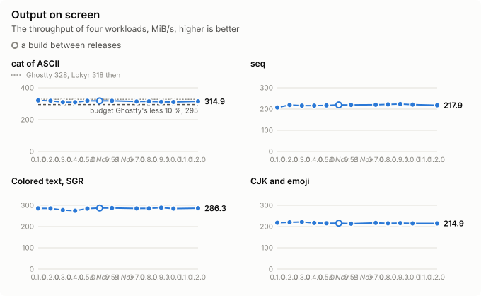

# The releases' benchmarks side by side

The last eight releases' measures, at a glance and in one table, each column of the A/B that measured it against the release before, at the conditions of [compare-F2-134](compare-F2-134.md): Menlo at 13 points, 120 × 40 cells, an opaque window, the main display at 60 Hz. Each release's notes tell the features that it brought and what they cost, as its session found. Each release's session adds its values, the window's motion among them, and its cells of the table of every measure with their notes, to [releases.json](releases.json), the data of the summary, the charts and the table below, which `just release-charts` draws again, and its features and their costs here; and takes the oldest release's away, which that release's own report keeps.

From 1.1.0 the sessions run of [a config of the least work](ab-F3b-20/config.toml) beside the terminal's own, no blinking nor ligatures, an opaque window, no quick tip, the same for every release from there, and 1.1.0's of the built-in display at 120 Hz: its column tells its latency, throughput and startup against 1.0.0's of its session, and the summary and the charts take its measures at rest alone, which neither the config nor the display moves. 1.2.0's session is of the display at 60 Hz again, of that config: its latency and its throughput join the charts, of a config that does less than the one before 1.1.0, as no blinking, which the releases before do not share; the startup's gap stays out of them, of a minimal app some 15 to 30 ms faster in the sessions from 1.1.0 on than before. 1.3.0's session is of a Dell U3417W at 60 Hz and a scale of 1, which halves the GPU's memory of both versions and takes away some of a live resize's missed refreshes, 1.2.0's 20 and 15 there against 33 and 31 in its own session; its minimal app started in 207 to 218 ms, as in the sessions before 1.1.0's, and its startup's gap joins the charts again.

Measures of different sessions compare within a few percent alone: a session's load and display move them, as each report tells; the A/B of a release against the one before, in one session of balanced orders, is what tells a cost. The window's motion, a drag by the titlebar and a live resize along a sine of 200 points, is measured as [motion-F3-152](motion-F3-152.md) measures it, of its config, Menlo at 20 points, 88 × 27 cells.

<!-- The summary and the charts, which tools/bench/releases.py writes from releases.json: edit those, not this. -->

## At a glance

1.3.0 against 1.2.0, both measured in 1.3.0's session, [ab-F5a-17](ab-F5a-17.md), but a measure that names another: each measure's change, the share of its budget, the best of the other terminals, of [the comparison of 13 November 2026](compare-F3-268.md) and [the window's motion](motion-F3-152.md), with Lokyr's own value of that session where its conditions differ, and whether it is as before, better, or worse beyond its rounds' spread.

| Measure | 1.2.0 | 1.3.0 | Change | Budget | The best of the others | |
|---|---|---|---|---|---|---|
| Startup, its gap to the minimal app's first window | 28.6 ms | 27.2 ms | −1.5 ms, −5 % | ≤ 35 ms, 78 % of it | — | ✔ As before |
| Latency, a key to its echo, p50 | 17.3 ms | 17.3 ms | +0.0 ms, +0 % | ≤ 33.3 ms, 52 % of it | Terminal.app 18.4, Lokyr 18.5 then | ✔ As before |
| Latency, a key to its echo, p99 | 32.4 ms | 31.5 ms | −0.9 ms, −3 % | ≤ 75 ms, 42 % of it | Alacritty 46, Lokyr 48.2 then | ✔ As before |
| Memory at rest, without the GPU's | 27.4 MB | 27.6 MB | +0.2 MB, +1 % | ≤ 35 MB, 79 % of it | Alacritty 31.1, Lokyr 27.8 then | ✔ As before |
| Idle, interrupt wakeups | 0.36/s | 0.36/s | ±0.00/s, ±0 % | ≤ 0.5/s, 72 % of it | Alacritty 0.37, Lokyr 0.35 then | ✔ As before |
| Idle, package idle wakeups | 0.00/s | 0.00/s | ±0.00/s | ≤ 0/s | — | ✔ As before |
| `cat` of 1 GiB of ASCII on screen | 298.6 MiB/s | 308.6 MiB/s | +10.0 MiB/s, +3 % | ≥ 294.9 MiB/s | Ghostty 328, Lokyr 318 then | ✔ As before |
| `seq 1 10000000` | 220.2 MiB/s | 218.3 MiB/s | −1.9 MiB/s, −1 % | — | — | ✔ As before |
| Colored text, SGR | 279.0 MiB/s | 285.2 MiB/s | +6.2 MiB/s, +2 % | — | — | ✔ As before |
| CJK and emoji | 217.2 MiB/s | 213.2 MiB/s | −4.0 MiB/s, −2 % | — | — | ✔ As before |
| A frame on the CPU, ASCII, p50 | 0.281 ms | 0.277 ms | −0.005 ms, −2 % | — | — | ✔ As before |
| A frame on the CPU, ASCII, p99 | 0.429 ms | 0.418 ms | −0.012 ms, −3 % | ≤ 2 ms, 21 % of it | — | ✔ As before |
| A frame on the CPU, CJK and emoji, p50 | 0.73 ms | 0.73 ms | −0.00 ms, −1 % | — | — | ✔ As before |
| A drag of the window, opaque, frames a second | 58.1/s | 58.3/s | +0.2/s, +0 % | — | Ghostty 58.3 | ✔ As before |
| A drag of the window, translucent with a blur, frames a second | 58.6/s | 58.5/s | −0.1/s, −0 % | — | Ghostty 57.3 | ✔ As before |
| A live resize, opaque, frames a second | 57.4/s | 57.4/s | ±0.0/s, ±0 % | — | Ghostty 57 | ✔ As before |
| A live resize, translucent with a blur, frames a second | 57.6/s | 57.6/s | +0.0/s, +0 % | — | Ghostty 57.7 | ✔ As before |
| A live resize, opaque, refreshes missed of 600 | 20.0 | 15.0 | −5.0, −25 % | — | Ghostty 25 | ✔ As before |
| A live resize, translucent with a blur, refreshes missed of 600 | 15.3 | 13.7 | −1.7, −11 % | — | Ghostty 17.5 | ✔ As before |
| A live resize, opaque, the compositor's delay, p95 | 13.2 ms | 21.0 ms | +7.8 ms, +59 % | — | Ghostty 27.7 | ✔ As before |
| A live resize, translucent with a blur, the compositor's delay, p95 | 18.3 ms | 18.4 ms | +0.1 ms, +1 % | — | Ghostty 27.5 | ✔ As before |

The latency's budgets, 2 refreshes at the p50 and 4.5 at the p99, set of a display at 120 Hz, are of these sessions' 60 Hz here: 33.3 and 75 ms. The throughput's of `cat` is the faster of Ghostty and Alacritty less 10 %, of [the comparison of 13 November 2026](compare-F3-268.md): Ghostty's 328 MiB/s.

## Over the releases

Each measure over the last eight releases, a dot of each release, its budget a dashed line, and the best of the other terminals a dotted one, of [the comparison of 13 November 2026](compare-F3-268.md), and of [the window's motion](motion-F3-152.md) for the window's motion, measured once of their versions then, Lokyr's own value of that session beside it where its conditions differ from the releases' sessions, the latency's by Typometer, of the screen; of the columns of [the table](#every-measure): different sessions, which compare within a few percent alone. A panel without a dashed line has no budget, as `seq`'s, SGR's, CJK's and the window's motion; without a dotted one, no other terminal was measured of it: that comparison timed no minimal app beside the others' first windows, which their startup's gap needs, nor the four workloads but `cat`, nor a frame's CPU.

<!-- The end of what tools/bench/releases.py writes. -->

## Every measure

<!-- The table of every measure, which tools/bench/releases.py writes from releases.json's `table`: edit that, not this. -->

Each release's measures in its own session: ▲ better and ▼ worse than the release before, as that session measured both, beyond the rounds' spread; ✖ past the budget; — not measured; the numbers, the notes under the table.

| Measure | Budget | [0.5.1](ab-F3-190.md) | [0.7.0](ab-F3-77.md) | [0.8.0](ab-F4-25.md) | [0.9.0](ab-F4-42.md) | [1.0.0](ab-F3-85.md) | [1.1.0](ab-F3b-20.md) | [1.2.0](ab-F3b-29.md) | [1.3.0](ab-F5a-17.md) |
|---|---|---:|---:|---:|---:|---:|---:|---:|---:|
| **Startup** | | | | | | | | | |
| Startup, warm, first frame, ms |  | 235.4 ¹ | 270.3 ² | 241.1 ³ | 248.5 ⁴ | 237.3 ⁵ | 245.6 ⁶ | 254.3 ⁷ | 238.6 ⁸ |
| Its gap to the minimal app's first window, ms | ≤ 35 | 26.6 ▼ | 18.8 ⁹ | 24.9 ▼ ¹⁰ | 25.4 ¹¹ | 26.7 ¹² | 52.2 ✖ ¹³ | 58.5 ✖ ¹⁴ | 27.2 ¹⁵ |
| **Latency** | | | | | | | | | |
| A key to its echo, p50, ms | ≤ 33.3 ¹⁶ | 18.9 | 20.2 | 19.6 | 20.6 | 19.2 | 13.9 ¹⁷ | 16.6 ▲ | 17.3 |
| A key to its echo, p99, ms | ≤ 75 ¹⁸ | 48.6 | 44.0 | 47.3 | 42.0 | 48.7 | 32.0 ¹⁷ | 31.5 | 31.5 |
| Its samples in the fourth refresh or later |  | 11 of 1592 | 7 of 1592 | 10 of 1592 | 3 of 1592 | 11 of 1592 | 46 of 1592 ¹⁷ | 0 of 1591 | 0 of 1592 |
| **At rest** | | | | | | | | | |
| Package idle wakeups, a second | 0 | 0 | 0 | 0 | 0 | 0 | 0 | 0 | 0 ¹⁹ |
| Interrupt wakeups, a second | ≤ 0.5 | 0.35 | 0.33 | 0.34 | 0.38 | 0.35 | 0.35 | 0.34 | 0.36 |
| Footprint without the GPU's, MB | ≤ 35 | 26.1 | 26.8 | 27.2 ▲ | 28.6 ²⁰ | 27.6 | 28.3 | 28.4 ²¹ | 27.6 ²² |
| GPU memory, MB |  | 30.3 | 30.1 | 30.1 | 30.1 | 30.1 | 30.6 | 30.6 | 14.2 ²³ |
| **Output on screen** | | | | | | | | | |
| `cat` of 1 GiB of ASCII, MiB/s | ≥ 294.9 ²⁴ | 318.6 | 314.3 | 315.0 | 311.9 | 310.9 | 271.1 ✖ ¹⁷ | 314.9 | 308.6 |
| `seq 1 10000000`, MiB/s |  | 219.6 | 220.3 | 222.1 | 223.8 | 220.9 | 192.6 ¹⁷ | 217.9 | 218.3 |
| Colored text, SGR, MiB/s |  | 287.4 | 285.5 | 285.6 | 288.9 | 284.7 | 234.7 ¹⁷ | 286.3 | 285.2 |
| CJK and emoji, MiB/s |  | 213.7 | 217.4 | 215.3 | 216.5 | 214.9 | 207.8 ¹⁷ | 214.9 | 213.2 |
| **A frame on the CPU** | | | | | | | | | |
| ASCII, p50, ms |  | 0.270 | 0.283 | 0.296 | 0.288 | 0.282 | 0.385 ¹⁷ | 0.298 | 0.277 |
| ASCII, p99, ms | ≤ 2 | 0.381 | 0.401 | 0.427 | 0.429 | 0.403 | 0.463 ¹⁷ | 0.423 | 0.418 |
| CJK and emoji, p50, ms |  | 0.72 ▼ | 0.71 | 0.72 | 0.73 | 0.73 | 0.79 ¹⁷ | 0.78 | 0.73 |
| **The window's motion** | | | | | | | | | |
| A drag, opaque, frames a second |  | 58.0 | 58.0 | — ²⁵ | — ²⁶ | — ²⁷ | 57.7 ²⁸ | 57.1 | 58.3 ²⁹ |
| A drag, with a blur, frames a second |  | 58.0 | 58.0 | — | — | — | 58.1 | 58.0 | 58.5 |
| A drag, opaque, refreshes missed of 600 |  | 15.5 | 16.0 | — | — | — | 16.0 | 23.0 | 7.5 |
| A drag, with a blur, refreshes missed of 600 |  | 16.5 | 16.5 | — | — | — | 15.0 | 16.0 | 9.0 |
| A live resize, opaque, frames a second |  | 56.2 | 56.3 | — | — | — | 56.2 | 55.7 | 57.4 |
| A live resize, with a blur, frames a second |  | 56.5 | 55.6 | — | — | — | 55.8 | 56.3 | 57.6 |
| A live resize, opaque, refreshes missed of 600 |  | 31.5 | 33.5 | — | — | — | 31.5 | 33.0 | 15.0 ³⁰ |
| A live resize, with a blur, refreshes missed of 600 |  | 30.0 | 39.5 | — | — | — | 36.5 | 31.0 | 13.7 |
| A live resize, opaque, the window server's CPU, % |  | 36 | 39 | — | — | — | 35 | 34 | 35 |
| A live resize, opaque, the app's CPU, % |  | 18 | 19 | — | — | — | 16 | 16 | 15 |
| A live resize, with a blur, the window server's CPU, % |  | 37 | 42 | — | — | — | 31 | 34 | 38 |
| A live resize, with a blur, the app's CPU, % |  | 18 | 20 | — | — | — | 15 | 15 | 15 |
| A live resize, opaque, the compositor's delay, p95, ms |  | 20.8 | 20.2 | — | — | — | 20.6 | 28.3 ³¹ | 21.0 ³² |
| A live resize, with a blur, the compositor's delay, p95, ms |  | 28.3 | 19.7 | — | — | — | 20.8 | 19.8 | 18.4 |

Notes:

1. 0.5.1 · Startup, warm, first frame, ms: the median of four rounds, 235.8, 234.8, 234.9 and 235.8.
2. 0.7.0 · Startup, warm, first frame, ms: the median of four rounds, 269.6, 272.1, 271.0 and 253.2.
3. 0.8.0 · Startup, warm, first frame, ms: the median of four rounds, 250.8, 248.4, 233.8 and 232.9.
4. 0.9.0 · Startup, warm, first frame, ms: the median of four rounds, 251.4, 249.8, 247.1 and 247.2.
5. 1.0.0 · Startup, warm, first frame, ms: the median of four rounds, 222.3, 240.5, 241.3 and 234.0.
6. 1.1.0 · Startup, warm, first frame, ms: the mean of eight rounds of copies started as often as 1.0.0's, 242.9; a new copy's four rounds 245.5, 243.8, 252.2 and 246.8.
7. 1.2.0 · Startup, warm, first frame, ms: the mean of eight rounds of copies started as often as 1.1.0's, 248.9; a new copy's four rounds 254.1, 262.8, 237.3 and 252.3.
8. 1.3.0 · Startup, warm, first frame, ms: the mean of eight rounds of copies started 60 times, 1.2.0's 240.0; four rounds of copies started 30 times 239.3, 270.6, 263.2 and 284.4.
9. 0.7.0 · Its gap to the minimal app's first window, ms: at rest, [startup-F3-228](startup-F3-228.md); 46.9 ms in the A/B, of a new copy.
10. 0.8.0 · Its gap to the minimal app's first window, ms: of a new copy started once before; 20.4 ms at rest against 0.7.0's 26.9, within the rounds' spread, [rest-F4-58](rest-F4-58.md#the-startup-at-rest).
11. 0.9.0 · Its gap to the minimal app's first window, ms: of a copy new out of its build started once before, against 0.8.0's 23.8 in the session.
12. 1.0.0 · Its gap to the minimal app's first window, ms: of a copy new out of its DMG started once before, against 0.9.0's 28.9 in the session.
13. 1.1.0 · Its gap to the minimal app's first window, ms: of a new copy against 1.0.0's 42.5 in the session, of a minimal app 15 ms faster than before; the startup 2.7 ms longer than 1.0.0's of copies started as often, [ab-F3b-20](ab-F3b-20.md#the-startup).
14. 1.2.0 · Its gap to the minimal app's first window, ms: of eight rounds against 1.1.0's 53.2, of a minimal app of 179 to 210 ms; the startup 5.3 ms longer, within the rounds' spread, [ab-F3b-29](ab-F3b-29.md#results).
15. 1.3.0 · Its gap to the minimal app's first window, ms: of eight rounds against 1.2.0's 28.6, of a minimal app of 207 to 218 ms, as before 1.1.0's sessions.
16. The budget · A key to its echo, p50, ms: 2 refreshes at 60 Hz, as the budget of 2 at 120 Hz.
17. 1.1.0: of its session on the built-in display at 120 Hz, of the config of the least work, against 1.0.0's of the same session.
18. The budget · A key to its echo, p99, ms: 4.5 refreshes at 60 Hz, as the budget of 4.5 at 120 Hz.
19. 1.3.0 · Package idle wakeups, a second: over 240 s, two rounds; 0.017 in two of four rounds of 60 s, of the same interrupt wakeups as 1.2.0's, [ab-F5a-17](ab-F5a-17.md#results).
20. 0.9.0 · Footprint without the GPU's, MB: the mean of two rounds, 30.4 and 26.9.
21. 1.2.0 · Footprint without the GPU's, MB: the mean of four rounds.
22. 1.3.0 · Footprint without the GPU's, MB: the median of four rounds, one of 31.5.
23. 1.3.0 · GPU memory, MB: of a display at a scale of 1, as 1.2.0's in the same session.
24. The budget · `cat` of 1 GiB of ASCII, MiB/s: Ghostty's 328 MiB/s of the comparison of 13 November 2026 less 10 %; 275 of the first comparison's before.
25. 0.8.0 · A drag, opaque, frames a second: not measured on this Mac, Microsoft Defender scanning the recordings; 0.7.0's on an M1 Max at 120 Hz, [rest-F4-58](rest-F4-58.md#the-windows-motion-on-the-m1).
26. 0.9.0 · A drag, opaque, frames a second: not measured on this Mac, Microsoft Defender scanning the recordings: 0.8.0's within that noise, [ab-F4-42](ab-F4-42.md#the-windows-motion).
27. 1.0.0 · A drag, opaque, frames a second: not measured.
28. 1.1.0 · A drag, opaque, frames a second: measured in 1.2.0's session.
29. 1.3.0 · A drag, opaque, frames a second: of 1.3.0's session on a Dell U3417W at 60 Hz, of two rounds of the opaque look and three of the blur.
30. 1.3.0 · A live resize, opaque, refreshes missed of 600: fewer on a display at a scale of 1, 1.2.0's 20.0 there.
31. 1.2.0 · A live resize, opaque, the compositor's delay, p95, ms: of runs of 13 or 28 ms for both versions, [ab-F3b-29](ab-F3b-29.md#the-windows-motion).
32. 1.3.0 · A live resize, opaque, the compositor's delay, p95, ms: of runs of 13 or 28 ms for both versions, [ab-F5a-17](ab-F5a-17.md#the-windows-motion).

<!-- The end of the table that tools/bench/releases.py writes. -->

The window's motion was first measured of 0.5.0, in [a motion session of 6 November](ab-F3-49.md#the-windows-motion), of the means of two rounds; [motion-F3-152](motion-F3-152.md) measured it of the builds before 0.5.0, against Ghostty's; 1.3.0's of two rounds of the opaque look and three of the blur. The latency's p50 and p99 are the means of the session's eight rounds. In 0.5.1's session, 0.5.0 measured 18.9 ms at the p50 and 46.6 ms at the p99, 9 samples in the fourth refresh or later, a startup's gap of 13.4 ms, 25.7 MB at rest, of the sessions' 25.6 and 25.7, 330.0 MiB/s of `cat` and a CJK frame of 0.44 ms, against which 0.5.1 is read; its motion, 57.4 and 57.2 frames a second of a drag, 55.8 and 56.2 of a resize, as 0.5.1's. The releases before 0.5.1 and the builds between them are in their own reports, from [ab-F3-13](ab-F3-13.md) on.

## The releases' features and their costs

- **0.5.1**, the plugins' block so far, released before the themes: the keymap's plugin, the tab bar with its drags, marks and looks, the splits, the windows' numbers, quitting with the last window, and the find bar with its highlights. Against 0.5.0 in [0.5.1's session](ab-F3-190.md), every budget holds: the latency, idle, the memory and the throughput are 0.5.0's within their spread, the footprint 0.5 MB larger. **The startup is 13 ms longer** in each of four rounds, its gap to the minimal app 26.6 ms against 13.4, within the budget of 35, the plugins' block's start. **A frame of CJK and emoji takes 0.27 ms more on the CPU**, and the p99 of the colored workloads' frames 1 to 2.5 ms more, of the same throughput, as in the build of 6 November. **A live resize** shows as many frames, of fewer missed refreshes, and one frame in twenty may come a refresh later, the compositor's delay at the 95th percentile 28 ms in three of four resizes against 13 to 15 in each of 0.5.0's of the session, though 0.5.0 showed 28 ms in two of four in the session of 6 November; the drags are 0.5.0's.
- **0.7.0**, the plugins' block's end and the daily features: the themes and their picker, the command palette, the shells' integration with its marks, gutter, header and notifications, the copy mode, the scroll bar, the programs' progress, the cursor's slide, windows restored, the Finder's services, the default terminal, Float on Top and the color scheme's reports. Against 0.5.1 in [0.7.0's session](ab-F3-77.md), every budget holds but the startup's gap: the latency's p50, idle, the memory, the throughput, the frames and the window's motion are 0.5.1's within their spread, the latency's p99 5.6 ms longer, within 0.7.0's spread, 7 samples in the fourth refresh against 1. The startup 30 ms longer in the session, its gap 46.9 ms past the budget of 35, of a copy freshly out of its DMG, which Microsoft Defender scanned at its starts; at rest, each copy started before, [startup-F3-228](startup-F3-228.md) found its gap 18.8 ms against 0.5.1's 15.1, within the budget and the spread, which the summary and the charts take, and the default terminal's look, on a thread of its own since the first draft, taking nothing of the start. The first draft's window, started from a shell, opened a second late and behind the app in front, which the motion's session found and a fix took away before the release.
- **0.8.0**, the Luau host's block: third-party plugins in Luau, each of a VM of its own and its sandbox, limits and watchdog, installed in a store and reloaded at once, the consent to their capabilities, and Sleip in the bundle, of `new`, `check`, `test`, `dev`, `add` and `update`. Against 0.7.0 in [0.8.0's session](ab-F4-25.md), every budget holds: the latency's p50, idle, the memory, the throughput and the frames are 0.7.0's within their spread; the latency's p99 7.4 ms longer, in seven rounds of eight, and the startup's gap 7 ms, of its first two rounds, within their budgets. [rest-F4-58](rest-F4-58.md) measured both again at rest: the startup 0.7.0's within its rounds' spread, the tail longer in some sessions of the managed Mac and not in others, of no code between the two, and of `allow-jit`, the entitlement of Luau's native code, not at all on a Mac of no management, an M1 Max, where the window's motion is 0.7.0's too; `allow-jit` stays. A Luau plugin active costs 0.9 MB, none without one; the app's code 2.6 MB larger, Luau's runtime 1.1 MB of it, the bundle 35.3 MB of Sleip's 13.1 and the DMG 14.7 MB.
- **0.9.0**, the plugin ecosystem's block: the registry, pkg.lokyr.dev, of its signed index, Sleip's `search`, `info`, `add` and `publish` of it, `snap`, `awake` and the font picker published, the host's images, save panel, power assertion and titlebar's buttons, the notices as cards and the quick tips. Against 0.8.0 in [0.9.0's session](ab-F4-42.md), every budget holds and no measure is worse beyond its spread: the latency's p50 0.2 ms shorter and its p99 1.1 ms longer, within the rounds' deviations; the startup's gap 1.5 ms longer, of its first round; the interrupt wakeups 0.38 a second against 0.35, of the account's own home alone, 0.35 of a home of its own. `awake` active and `snap` installed cost 1.6 and 1.9 MB, none at rest; the quick tips no timer at a start of no tip due. The bundle 40.4 MB, Sleip's 16.1 of its registry's client, and the released DMG of 17.7 MB. The window's motion, measured while Microsoft Defender scanned Instruments' recordings, as in 0.8.0's session, showed both apps at half their frames, 0.9.0 0.8.0's within that noise.
- **1.0.0**, the first public release: the AI agents on their tabs, their notifications, the Dock's badge and Claude Code's integration, a path opened at its line in the editor, a command's output copied or selected, inline images of iTerm2's and kitty's protocols, and the Homebrew cask. Against 0.9.0 in [1.0.0's session](ab-F3-85.md), every budget holds and no measure is worse beyond its spread: the latency's p50 0.9.0's and its p99 1.1 ms longer, within the rounds' deviation; the startup's gap 2.1 ms shorter; the footprint 0.5 MB larger, of a binary 0.5 MB larger; idle and the throughputs 0.9.0's. The window's motion was not measured.
- **1.1.0**, the settings in a window of their own: every key of the config, the keys' bindings, the themes' previews and the plugins, without editing a file. Against 1.0.0 in [1.1.0's sessions](ab-F3b-20.md), of the new config and the built-in display at 120 Hz, no measure is worse beyond its spread: the latency's p50 0.5 ms shorter and its p99 1.0.0's; idle 1.0.0's; the footprint 0.4 MB larger, of a binary 1 MB larger; the throughputs within their runs' spread; a frame of ASCII 0.018 ms longer on the CPU, 5 %, of no throughput lost. The startup is 2.7 ms longer, of copies started as often, within the rounds' spread: the sessions found 6.6 and 9.7 ms of a new copy, which a binary that the system has seen little of starts slower, as 1.0.0 rebuilt of its tag did by 16 ms. The startup's gap to the minimal app and `cat`'s throughput held for neither version, of a minimal app 15 ms faster than in the sessions before and of the display at 120 Hz. The window's motion was not measured.
- **1.2.0**, themes made in the app: the Theme Editor of every color of a theme, its values edited of a field or the system's color panel and written into the theme's file, and its previews of a window and of a plugin's panel in the theme edited; themes made, duplicated, converted and imported in the app; the interface's colors of rules that follow the theme's own; faint text, the cursor guide and the HDR cursor; the settings' Keys page; the settings window of Lokyr's own themes. Against 1.1.0 in [1.2.0's sessions](ab-F3b-29.md), of the display at 60 Hz, every budget holds but the startup's gap, which holds for neither version, and no measure is worse beyond its spread: the latency's p50 1.1 ms shorter, in seven rounds of eight, and its p99 1.1.0's; idle, the throughputs and the frames 1.1.0's; the footprint 0.5 MB larger, in each of four rounds, of the app's heap, of a binary 0.7 MB larger. The startup is 5.3 ms longer, of copies started as often, within the rounds' spread. The window's motion, measured of both in its session, is 1.1.0's: as many frames a second of a drag and of a resize, as many refreshes missed, the same CPU; the compositor's delay at the 95th percentile a refresh longer in more of 1.2.0's runs, in a session whose load rose, its median 13 ms for both.
- **1.3.0**, the programs' status, the prompt's click and the tabs: a program's status of OSC 7501 on its tab, a session's status of OSC 21337 and the notifications of OSC 99; a click in the command line that moves the shell's cursor, and a selection there that typing replaces; ⌃Tab of the tabs used last, pinned tabs, tab groups and a closed tab reopened; hints of the screen's URLs, paths, hashes and addresses, labeled to open or copy; the quick terminal of a double-tapped modifier; Use Transparency; the settings' editor of the hints' patterns; and the text fields' keys and context menu. Against 1.2.0 in [1.3.0's session](ab-F5a-17.md), of a display at a scale of 1, every budget holds and no measure is worse beyond its spread: the latency's p50 1.2.0's and its p99 0.9 ms shorter; the startup 1.5 ms shorter, of copies started as often, its gap to the minimal app 27.2 ms, within the budget; the footprint 0.2 MB larger, of a binary 0.7 MB larger; idle 1.2.0's, of no package idle wakeup over four minutes of each, the two of 1.3.0's in the rounds of 60 s chance of the same interrupt wakeups; `cat` 3 % faster and CJK and emoji 1.8 % slower, within their tolerance of 5 %, of the same frames' CPU. The window's motion is 1.2.0's, as many frames a second of a drag and of a resize, the compositor's delay at the 95th percentile of runs of 13 or 28 ms for both.

## Every report

Every session's report, the newest first.

| Date | Report |
|---|---|
| 18 November 2026 | [1.3.0 against 1.2.0](ab-F5a-17.md) |
| 16 November 2026 | [1.2.0 against 1.1.0](ab-F3b-29.md) |
| 14 November 2026 | [1.1.0 against 1.0.0](ab-F3b-20.md) |
| 13 November 2026 | [Lokyr against the other terminals, again](compare-F3-268.md) |
| 13 November 2026 | [1.0.0 against 0.9.0](ab-F3-85.md) |
| 12 November 2026 | [The inline images' cost when none shows](ab-F3-249.md) |
| 11 November 2026 | [0.9.0 against 0.8.0](ab-F4-42.md) |
| 9 November 2026 | [0.8.0's latency tail, startup and motion again, and `allow-jit`](rest-F4-58.md) |
| 9 November 2026 | [0.8.0 against 0.7.0](ab-F4-25.md) |
| 8 November 2026 | [The startup's gap at rest](startup-F3-228.md) |
| 8 November 2026 | [The cursor's movement's cost](movement-F3-72.md) |
| 8 November 2026 | [Lokyr again, against the other terminals of the first comparison](compare-F3-72.md) |
| 8 November 2026 | [0.7.0 against 0.5.1](ab-F3-77.md) |
| 7 November 2026 | [The search of 100 000 lines through the app's service](search-F3-52.md) |
| 7 November 2026 | [0.5.1 against 0.5.0](ab-F3-190.md) |
| 6 November 2026 | [The build of 6 November against 0.5.0, and the single tab's title](ab-F3-49.md) |
| 5 November 2026 | [The window's motion, its resize and the cursor's fades](motion-F3-152.md) |
| 5 November 2026 | [The latency beside a plugin on its own thread that renders without pause](latency-F3-35.md) |
| 5 November 2026 | [The latency's tail and the startup of 0.5.0, bisected](latency-F3-163.md) |
| 5 November 2026 | [0.5.0 against 0.4.0](ab-F3-40.md) |
| 4 November 2026 | [The latency's tail of 0.4.0, a first session](latency-F3-135.md) |
| 4 November 2026 | [0.4.0 against 0.3.0](ab-F3-29.md) |
| 2 November 2026 | [The first frame a refresh later than 0.2.0's](startup-F3-105.md) |
| 2 November 2026 | [0.3.0 against 0.2.0](ab-F3-83.md) |
| 2 November 2026 | [The architecture of the MVP against the single pane's](ab-F3-13.md) |
| 31 October 2026 | [Startup](startup-F2-53.md) |
| 31 October 2026 | [CPU per frame and throughput on screen](onscreen-F2-56.md) |
| 31 October 2026 | [Latency](latency-F2-54.md) |
| 31 October 2026 | [A frame's new glyphs](glyphs-F2-146.md) |
| 31 October 2026 | [Lokyr against the other terminals](compare-F2-134.md) |
| 30 October 2026 | [Drawables at 60 Hz](drawables-F2-57.md) |
| 29 October 2026 | [Idle, memory and GPU memory](idle-memory-F2-55.md) |
| 25 October 2026 | [Throughput of the finished VT core](throughput-F1-56.md) |
| 23 October 2026 | [Throughput after the performance fixes](throughput-F1-51.md) |
| 23 October 2026 | [Throughput of the review fixes](throughput-F1-133.md) |
| 20 October 2026 | [Instruction counts in CI](instructions-F1-52.md) |
| 19 October 2026 | [Throughput of the VT core](throughput-F1-50.md) |
| 19 October 2026 | [Search over the scrollback](search-F1-54.md) |
| 18 October 2026 | [esctest, after the second compatibility fixes](esctest-F1-46.md) |
| 18 October 2026 | [esctest, after the first compatibility fixes](esctest-F1-45.md) |
| 18 October 2026 | [esctest, before the compatibility fixes](esctest-F1-44.md) |
| 12 October 2026 | [The baseline of the existing terminals](baseline-F0.md) |
