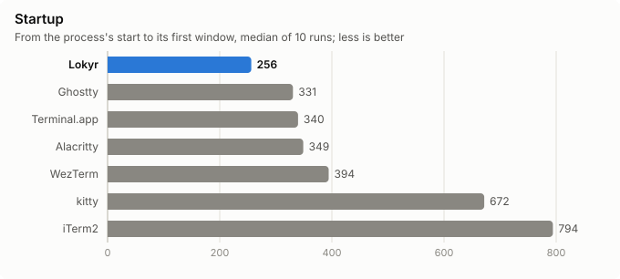
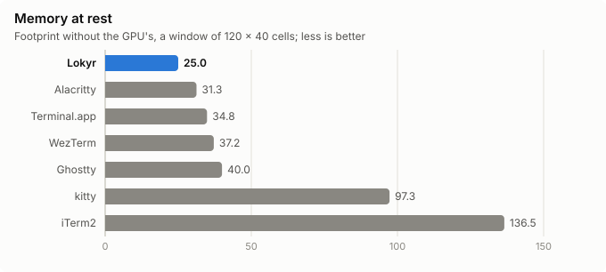
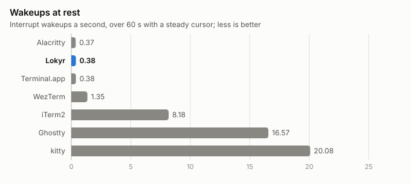
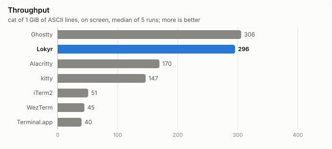
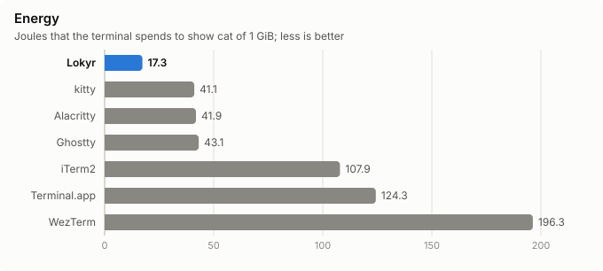

# Lokyr against the other terminals (F2-134)

Measured on 2026-10-31, in five sessions between 14:54 and 22:30, on the bundle of commit fe0cbe0, with this task's change of `lokyr --bench output`, which takes the config's columns and rows without `--window` and through which `compare.py` runs each measure's program in Lokyr, against Ghostty, Alacritty, kitty, WezTerm, iTerm2 and Terminal.app, under the same conditions. The raw results, the configs and each terminal's reports are in [compare-F2-134/](compare-F2-134/); `python3 tools/bench/compare.py` takes the measures again, and `python3 tools/bench/report_charts.py compare` draws the charts from the raw results.

## In short

| Measure | Lokyr | Its place of 7 | The best of the others |
|---|---|---|---|
| Startup to the first window, median | 256 ms | 1st | Ghostty, 331 ms |
| Memory at rest, without the GPU's | 25.0 MB | 1st | Alacritty, 31.3 MB |
| Interrupt wakeups at rest | 0.38 a second | 2nd, with Terminal.app | Alacritty, 0.37 |
| `cat` of 1 GiB on screen | 296 MiB/s | 2nd | Ghostty, 306 MiB/s |
| Energy to show that GiB | 17.3 J | 1st | kitty, 41.1 J |
| kitty's benchmark, short CSI sequences | 58 MB/s | 4th | Ghostty, 221 MB/s |

## Conditions

- **The machine**: an Apple M5 Pro (Mac17,8), macOS 27.2 (26B123), on AC power, Low Power Mode off; the main display a 6016 × 3384 panel at 60 Hz, as 3008 × 1692 points, on which every window opened. The user's apps stayed open, among them VS Code, Android Studio and Chrome, and Microsoft Defender scanned: a session's figures moved with them, as below, and each measure of a terminal against the others comes of one session.
- **Each terminal**: Menlo at 13 points, no ligatures, a grid of 120 by 40 cells, which `compare.py check` saw through `stty size` in each; a steady cursor, an opaque window without blur, about 10 000 rows of scrollback, no window restored, no shell integration; the configs are in [configs/](compare-F2-134/configs/), and Terminal.app's profile, which `compare.py setup` writes, has the same.
- **The shell**: zsh with `ZDOTDIR` an empty directory, of its plain prompt, in each.
- **The defaults that the measures depend on**, left as they are: Ghostty's `window-vsync = true`; kitty's `input_delay 3`, `repaint_delay 10` and `sync_to_monitor yes`; WezTerm's `front_end = "WebGpu"` and `max_fps = 60`.
- **The versions**:

| Terminal | Version |
|---|---|
| Lokyr | fe0cbe0 |
| Ghostty | 1.3.2-main+62fa23bfa, a build of its tip |
| Alacritty | 0.18.0-dev, bbb2cbf of 26 October 2026, built here |
| kitty | 0.49.2 |
| WezTerm | 20240203-110809-5046fc22 |
| iTerm2 | 3.7.6 |
| Terminal.app | 2.15 (488.9) |

## Startup

`lokyr-bench startup`, which launches each terminal through LaunchServices and times its first window on screen from the process's start, a run to warm up and five, twice, the terminals' order turned between the rounds; and Lokyr's own first frame, as its presented handler tells it.

| Terminal | Median | p90 | Spread | Fastest | Slowest |
|---|---|---|---|---|---|
| **Lokyr** | **256.2 ms** | 260.2 | 0.12 | 211.9 | 278.3 |
| Ghostty | 330.6 ms | 344.3 | 0.13 | 283.4 | 361.9 |
| Terminal.app | 339.6 ms | 377.2 | 0.16 | 319.8 | 397.5 |
| Alacritty | 349.0 ms | 368.6 | 0.13 | 310.6 | 369.7 |
| WezTerm | 394.3 ms | 416.5 | 0.17 | 341.7 | 422.1 |
| kitty | 671.7 ms | 683.1 | 0.03 | 659.2 | 696.1 |
| iTerm2 | 794.2 ms | 1 207.8 | 0.64 | 695.0 | 1 250.7 |

Lokyr's first frame, as its presented handler tells it, in runs of its own, came at 235.1 ms at the median, p90 253.8.

## At rest

Each terminal alone, 10 s after its start, then 60 s of `lokyr-bench idle` and of its energy, then its memory, over the processes of its bundle, without the shell.

| Terminal | Processes | Package idle wakeups | Interrupt wakeups | Footprint without the GPU's | The GPU's | Energy |
|---|---|---|---|---|---|---|
| **Lokyr** | lokyr | 0 a second | 0.38 | **25.0 MB** | 30.5 MB | 0.07 mW |
| Ghostty | ghostty | 0.05 | 16.57 | 40.0 MB | 130.7 MB | 0.52 mW |
| Alacritty | alacritty | 0 | 0.37 | 31.3 MB | 52.1 MB | 0.07 mW |
| kitty | kitty, two kittens | 0 | 20.08 | 97.3 MB | 41.9 MB | 0.15 mW |
| WezTerm | wezterm-gui | 0 | 1.35 | 37.2 MB | 56.9 MB | 0.09 mW |
| iTerm2 | iTerm2, pidinfo, the session's server | 0.02 | 8.18 | 136.5 MB | 184.4 MB | 5.45 mW |
| Terminal.app | Terminal | 0 | 0.38 | 34.8 MB | 15.2 MB | 0.07 mW |

- Lokyr is within its [budgets](../PERFORMANCE.md#budgets): no package idle wakeup, 0.38 interrupt wakeups a second, of ≤ 0.5, and 25.0 MB, of ≤ 35.
- iTerm2's figure has the server of its session, 2.2 MB, which [idle/iterm2-server.json](compare-F2-134/idle/iterm2-server.json) measured apart, as iTerm2's servers live outside its bundle.

## Throughput

In each terminal's window, one after the other: kitty's `kitten __benchmark__`, three times without its `--render` and three times with it; vtebench, at commit ead8003, five seconds a scenario; and `cat` of 1 GiB of lines of ASCII, ended with a query of the cursor, five times. F2-56's [measures of Lokyr's own](onscreen-F2-56.md), of other workloads, come with these.

### kitty's benchmark

Without `--render`, MB/s, the median of 3 runs; more is better:

| Terminal | ASCII | Unicode | Unique clusters of several codepoints | Short CSI sequences | Long escape sequences | Images |
|---|---|---|---|---|---|---|
| **Lokyr** | 314 | 298 | 75 | **58** | 317 | 317 |
| Ghostty | 316 | 320 | 104 | 221 | 320 | 320 |
| Alacritty | 117 | 138 | 81 | 94 | 232 | 240 |
| kitty | 173 | 166 | 57 | 114 | 273 | 248 |
| WezTerm | 39 | 75 | 95 | 22 | 286 | 257 |
| Terminal.app | 30 | 41 | 22 | 32 | 59 | 49 |

- With `--render`, the figures are the same within 5%, but Alacritty's, which are faster, 196 MB/s of ASCII and 126 of short CSI sequences, and WezTerm's clusters of several codepoints, 9 MB/s.
- The benchmark waits for an answer that iTerm2 never gives, and was left out of iTerm2's measures.
- Lokyr is within 10% of Ghostty in four tests of six. **Short CSI sequences**, at 0.26 of Ghostty's rate, and **unique clusters of several codepoints**, at 0.72, are past the budget of throughput, within 10% of the faster of Ghostty and Alacritty.

### vtebench

The median time of a scenario's samples, in milliseconds; less is better. vtebench's time ends as the PTY takes the bytes, not as the terminal shows them, in whole milliseconds:

| Scenario | Lokyr | Ghostty | Alacritty | kitty | WezTerm | iTerm2 | Terminal.app |
|---|---|---|---|---|---|---|---|
| `dense_cells` | **4** | 5 | 5 | 8 | 8 | 124 | 25 |
| `medium_cells` | **4** | 4 | 6 | 7 | 33 | 381 | 43 |
| `scrolling` | **8** | 12 | 19 | 64 | 67 | 28 | 146 |
| `scrolling_bottom_region` | **9** | 13 | 10 | 37 | 63 | 548 | 124 |
| `scrolling_bottom_small_region` | **9** | 13 | 10 | 37 | 63 | 546 | 124 |
| `scrolling_fullscreen` | **9** | 16 | 36 | 156 | 78 | 37 | 148 |
| `scrolling_top_region` | **14** | 12 | 29 | 26 | 81 | 2 710 | 123 |
| `scrolling_top_small_region` | **9** | 13 | 10 | 36 | 62 | 546 | 124 |
| `sync_medium_cells` | **4** | 4 | 9 | 14 | 46 | 361 | 44 |
| `unicode` | **3** | 3 | 6 | 7 | 20 | 34 | 59 |

- Lokyr is the fastest, or as fast as the fastest, in every scenario but **`scrolling_top_region`**, 14 ms against Ghostty's 12, a sixth more, past the budget.
- iTerm2 took only two samples of some scenarios in five seconds.

### `cat` of 1 GiB

| Terminal | Median | Its 5 runs |
|---|---|---|
| Ghostty | 305.6 MiB/s | 300.3 to 307.8 |
| **Lokyr** | **295.5 MiB/s** | 290.1 to 296.4 |
| Alacritty | 169.6 MiB/s | 169.0 to 170.8 |
| kitty | 146.7 MiB/s | 145.7 to 148.3 |
| iTerm2 | 51.0 MiB/s | 50.1 to 51.1 |
| WezTerm | 44.6 MiB/s | 44.2 to 44.7 |
| Terminal.app | 39.9 MiB/s | 39.8 to 40.1 |

Lokyr is at 0.97 of Ghostty's rate, within the budget.

### A session that slowed Lokyr

The first session of throughput, at 15:28, ran Lokyr first. Its first run of kitty's benchmark matched the figures above; from the second on, every test fell by a third or more, ASCII to 211 MB/s, short CSI sequences to 26, vtebench's scenarios took three to five times as long, and `cat` ran at 62 MiB/s. Lokyr used the same CPU throughout, about 1.1 to 1.3 cores, as `powermetrics` saw. No state of the terminal explained it: neither vtebench, the alternate screen, each of the benchmark's tests in turn, two whole runs of it, nor the app hidden or in the background slowed it again. A fourth session measured Lokyr again, with Ghostty as the control, whose figures matched the first session's within 2%; the tables above are that session's, and the first one's are in [throughput/lokyr-disturbed/](compare-F2-134/throughput/lokyr-disturbed/).

## Energy

`lokyr-bench energy`, which reads the energy that the kernel bills each process, `ri_energy_nj` of `proc_pid_rusage`, and needs no administrator, over `cat` of 1 GiB in each terminal, all of them in one session: the same bytes in each, whatever its rate.

| Terminal | A GiB | At |
|---|---|---|
| **Lokyr** | **17.3 J** | 298.5 MiB/s |
| kitty | 41.1 J | 145.3 MiB/s |
| Alacritty | 41.9 J | 168.8 MiB/s |
| Ghostty | 43.1 J | 300.2 MiB/s |
| iTerm2 | 107.9 J | 102.8 MiB/s |
| Terminal.app | 124.3 J | 38.7 MiB/s |
| WezTerm | 196.3 J | 44.0 MiB/s |

- Lokyr spends 0.4 of Ghostty's energy at the same rate.
- The window server's composition is each terminal's cost too, and these figures leave it out: `powermetrics`, which reads it, needs an administrator, and is the user's part.
- iTerm2's rate moved between sessions, from 10 to 103 MiB/s in a new window, and 51 in the window of the throughput's session.
- Ten seconds of `yes`, in the first session, are not comparable across terminals, whose rates differ: they are in [idle/](compare-F2-134/idle/).

## Unicode

`ucs-detect` 2.3.8, of Unicode 18, in each terminal: the share of the sequences of each kind that the terminal draws as wide as `wcwidth` 0.9.4 measures them.

| Terminal | Wide | Emoji ZWJ | VS16 | VS15 | Narrow | Flags | A lone regional indicator | Languages, all right | Their clusters |
|---|---|---|---|---|---|---|---|---|---|
| **Lokyr** | 94.9% | 100% | 100% | 100% | 100% | 100% | **0%** | 57 of 85 | **43.9%** of 6 589 |
| Ghostty | 99.8% | 100% | 100% | 100% | 99.9% | 100% | 100% | 83 of 85 | 99.5% of 6 589 |
| Alacritty | 94.9% | 0.7% | 50.0% | 0% | 99.6% | 100% | 0% | 63 of 85 | 84.4% of 6 589 |
| kitty | 100% | 100% | 97.9% | 100% | 99.6% | 100% | 100% | 60 of 85 | 18.6% of 3 788 |
| WezTerm | 54.9% | 100% | 50.0% | 0% | 99.7% | 100% | 0% | 61 of 85 | 53.7% of 2 175 |
| iTerm2 | 99.8% | 100% | 100% | 0% | 100% | 100% | 100% | 74 of 85 | 76.6% of 474 |
| Terminal.app | 94.9% | 0% | 50.0% | 0% | 98.3% | 98.9% | 0% | 62 of 85 | 81.0% of 6 589 |

- **Lokyr's emoji are all right**, as Ghostty's.
- **A lone regional indicator**, as 🇦 without a second one to make a flag, takes one cell in Lokyr, as Markus Kuhn's `wcwidth`, Alacritty, WezTerm and Terminal.app give it, and two in Ghostty, kitty, iTerm2 and `wcwidth` 0.9.4; the 26 of them are all of Lokyr's errors of wide characters too.
- **The languages**: a consonant with a vowel sign that spaces, as Bengali's ক with া, which `wcwidth` 0.9.4 and Ghostty count as two cells, as a classic `wcwidth` gives one to each of its two codepoints, takes the width of its base in Lokyr, one cell. A shell or an editor that counts with the system's `wcwidth` puts its cursor a cell further than Lokyr shows it, in Hindi, Bengali, Tamil, Malayalam and the other scripts of South and Southeast Asia.
- ucs-detect stops each kind after 10 s: kitty, WezTerm and iTerm2 measured fewer clusters of the languages. In iTerm2, which leaves one of its queries of the terminal's features unanswered, it ran without them.

## The Metal HUD

The HUD's log, `MTL_HUD_ENABLED` and `MTL_HUD_LOG_ENABLED`, over 10 s of `yes`, gave nothing comparable: only Lokyr and iTerm2 logged, their fields private but three numbers, which Apple does not document; and iTerm2 crashed in the HUD's own code, `-[HUDMTLLayerTracking safeAreaInsets]`, twice. The frames' pacing needs another tool: the counter of a window's frames through ScreenCaptureKit that the task's notes propose, or Instruments.

## What this leaves

- **Tasks** for the gaps past the budget of throughput: kitty's short CSI sequences, at 0.26 of Ghostty's rate; its unique clusters of several codepoints, at 0.72; vtebench's `scrolling_top_region`, a sixth slower than Ghostty.
- **The user's choice**: the width of a lone regional indicator, and of a cluster with a vowel sign that spaces.
- **The user's part**, which the report waits for: the latency with Typometer, alone and next to a flood, at 60 and 120 Hz, which Lokyr's own measure calibrates; Is It Snappy, 30 takes a terminal; `powermetrics`, of each terminal and of the window server; the MacBook's display at 120 Hz; the smoothness, by eye; vttest's screens.
