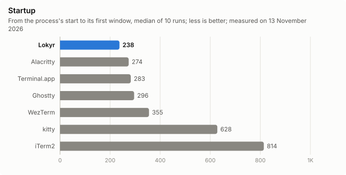
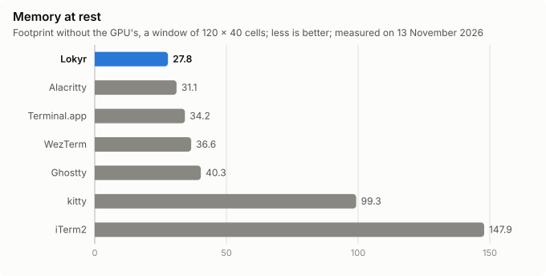
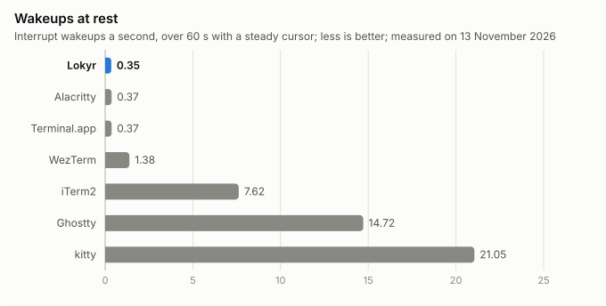
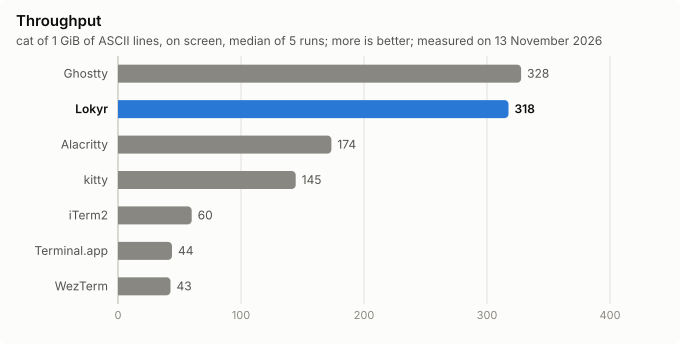
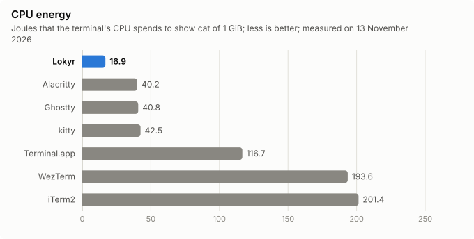
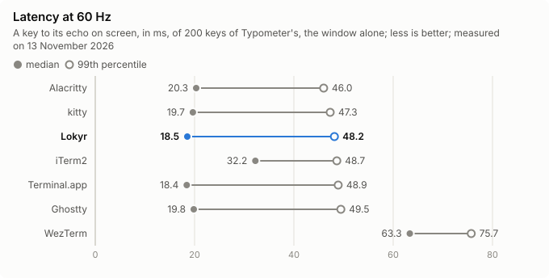

# Lokyr against the other terminals, again

Measured on 13 November 2026, from 07:53 to 10:01, on main's build of commit b5eab8e2, Lokyr 0.9.0 of 1.0.0's code, against Ghostty, Alacritty, kitty, WezTerm, iTerm2 and Terminal.app, each of its version of that day, in one session: every terminal of [the first comparison](compare-F2-134.md) measured again, by its tool, `compare.py`, of its conditions and its configs. The machine's measures ran by themselves from 07:53 to 09:14; Typometer's latency, at 60 Hz, came by hand from 09:20 to 10:01. The raw results are in [compare-F3-268/](compare-F3-268/), the session's script in [run.sh](compare-F3-268/run.sh) and its log in [session.log](compare-F3-268/session.log); `python3 tools/bench/compare_tables.py` makes the tables of the raw results, and `python3 tools/bench/report_charts.py compare` draws the charts, which the README shows.

The figures of this report compare within it alone: those of the first comparison came of other versions, another day's load and, for the latency, another display.

## In short

| Measure | Lokyr | Its place of 7 | The best of the others |
|---|---|---|---|
| Startup to the first window, median | 237.5 ms | 1st | Alacritty, 274.1 ms |
| Memory at rest, without the GPU's | 27.8 MB | 1st | Alacritty, 31.1 MB |
| Interrupt wakeups at rest | 0.35 a second | 1st | Alacritty and Terminal.app, 0.37 |
| `cat` of 1 GiB on screen | 317.5 MiB/s | 2nd | Ghostty, 327.7 MiB/s |
| The CPU's energy to show that GiB | 16.9 J | 1st | Alacritty, 40.2 J |
| kitty's benchmark, its six tests | The fastest, or equal, in each | 1st | Ghostty, equal in long escape sequences |
| A key to its echo at 60 Hz, median | 18.5 ms | 2nd | Terminal.app, 18.4 ms |
| A key to its echo at 60 Hz, p90 | 24.4 ms | 1st | Alacritty, 27.3 ms |
| A key to its echo at 60 Hz, next to a flood, median | 25.0 ms | 2nd of 6 | Alacritty, 16.6 ms |

The latency at 120 Hz was not measured again: [its chart](compare-F3-268/charts/latency-120hz.svg) is the first comparison's, of 1 November 2026 and of the versions of then.

## Conditions

- **The machine**: an Apple M5 Pro (Mac17,8), macOS 27.2.1 (26B131), on AC power; the main display a Dell P2721Q at 60 Hz, 5120 × 2880 pixels as 2560 × 1440 points, on which every window opened. Other apps stayed open, as on any working day; the load averaged 2.3 to 5.3 over the minute as each measure began, as the log tells.
- **Each terminal**: Menlo at 13 points, no ligatures, a grid of 120 by 40 cells, which `compare.py check` saw through `stty size` in each; a steady cursor, an opaque window without blur, about 10 000 rows of scrollback, no window restored, no shell integration: [the first comparison's configs](compare-F2-134/configs/), and the profile of Terminal.app that `compare.py setup` writes.
- **The shell**: zsh with `ZDOTDIR` an empty directory, of its plain prompt, in each.
- **The defaults that the measures depend on**, left as they are: Ghostty's `window-vsync = true`; kitty's `input_delay 3`, `repaint_delay 10` and `sync_to_monitor yes`; WezTerm's `front_end = "WebGpu"` and `max_fps = 60`.
- **The versions**:

| Terminal | Version |
|---|---|
| Lokyr | 0.9.0-20261113, main's build of b5eab8e2 |
| Ghostty | 1.4.0 (18457) |
| Alacritty | 0.17.0 (94e7c88), built of its tag, as Homebrew's cask is disabled |
| kitty | 0.50.0 |
| WezTerm | 20240203-110809-5046fc22 |
| iTerm2 | 3.7.7 |
| Terminal.app | 2.15 (488.9) |

## Startup

`lokyr-bench startup`, which launches each terminal through LaunchServices and times its first window on screen from the process's start, a run to warm up and five, twice, the terminals' order turned between the rounds; and Lokyr's own first frame, as its presented handler tells it, in runs of its own. The spread is the range from the 10th to the 90th percentile, as a fraction of the median.

| Terminal | Median | p90 | Spread | Fastest | Slowest |
|---|---|---|---|---|---|
| **Lokyr** | **237.5 ms** | 249.2 | 0.09 | 221.2 | 253.0 |
| Alacritty | 274.1 ms | 288.2 | 0.09 | 257.4 | 298.5 |
| Terminal.app | 282.5 ms | 293.2 | 0.08 | 263.7 | 308.8 |
| Ghostty | 296.0 ms | 308.9 | 0.15 | 264.4 | 313.4 |
| WezTerm | 355.4 ms | 360.4 | 0.06 | 331.4 | 362.7 |
| kitty | 628.4 ms | 635.2 | 0.03 | 613.8 | 641.9 |
| iTerm2 | 814.0 ms | 826.0 | 0.02 | 806.9 | 826.5 |

- Lokyr's first frame came at 252.2 ms at the median, p90 257.6, a spread of 0.08, as the releases' sessions found of 0.9.0, 247 to 251 ms.
- Ghostty, Alacritty, kitty, WezTerm and Terminal.app started 35 to 75 ms sooner than in the first comparison, iTerm2 20 ms later, and Lokyr 19 ms sooner: that session's machine was the busier, as [the measure of Lokyr alone of 8 November](compare-F3-72.md) found, 236 ms of the same conditions.

## At rest

Each terminal alone, 10 s after its start, then 60 s of `lokyr-bench idle` and of its energy, then its memory, over the processes of its bundle, without the shell, iTerm2's session server among them.

| Terminal | Processes | Package idle wakeups | Interrupt wakeups | Footprint without the GPU's | The GPU's | Energy |
|---|---|---|---|---|---|---|
| **Lokyr** | lokyr | 0 a second | **0.35** | **27.8 MB** | 30.6 MB | 0.06 mW |
| Ghostty | ghostty | 0 | 14.72 | 40.3 MB | 132.9 MB | 0.43 mW |
| Alacritty | alacritty | 0 | 0.37 | 31.1 MB | 52.1 MB | 0.06 mW |
| kitty | kitty, two kittens | 0 | 21.05 | 99.3 MB | 42.7 MB | 0.15 mW |
| WezTerm | wezterm-gui | 0 | 1.38 | 36.6 MB | 56.9 MB | 0.09 mW |
| iTerm2 | iTerm2, pidinfo and the session's server | 0 | 7.62 | 147.9 MB | 186.1 MB | 5.35 mW |
| Terminal.app | Terminal | 0 | 0.37 | 34.2 MB | 15.2 MB | 0.06 mW |

Lokyr is within its [budgets](../PERFORMANCE.md#budgets): no package idle wakeup, 0.35 interrupt wakeups a second, of ≤ 0.5, and 27.8 MB, of ≤ 35.

## Throughput

In each terminal's window, one after the other: kitty's `kitten __benchmark__`, three times without its `--render` and three times with it; vtebench, at commit ead8003, five seconds a scenario; and `cat` of 1 GiB of lines of ASCII, ended with a query of the cursor, five times.

### kitty's benchmark

Without `--render`, MB/s, the median of 3 runs; more is better:

| Terminal | ASCII | Unicode | Unique clusters of several codepoints | Short CSI sequences | Long escape sequences | Images |
|---|---|---|---|---|---|---|
| **Lokyr** | **308** | **313** | **117** | **234** | 310 | **311** |
| Ghostty | 307 | 308 | 104 | 229 | 310 | 308 |
| Alacritty | 104 | 117 | 66 | 94 | 200 | 221 |
| kitty | 178 | 174 | 57 | 115 | 288 | 271 |
| WezTerm | 39 | 74 | 94 | 23 | 280 | 260 |
| Terminal.app | 31 | 42 | 24 | 33 | 70 | 51 |

- With `--render`, the figures are the same within 5%, but Alacritty's, which are faster, 199 MB/s of ASCII and 123 of short CSI sequences, and WezTerm's clusters of several codepoints, 12 MB/s.
- The benchmark waits for an answer that iTerm2 never gives, and was left out of iTerm2's measures.
- Lokyr is the fastest or as fast as the fastest in each test, within the budget of throughput, 10% of the faster of Ghostty and Alacritty, in all six.

### vtebench

The median time of a scenario's samples, in milliseconds; less is better. vtebench's time ends as the PTY takes the bytes, not as the terminal shows them, in whole milliseconds:

| Scenario | Lokyr | Ghostty | Alacritty | kitty | WezTerm | iTerm2 | Terminal.app |
|---|---|---|---|---|---|---|---|
| `dense_cells` | **4** | 4 | 4 | 7 | 7 | 125.5 | 22 |
| `medium_cells` | **3** | 3 | 6 | 7 | 32 | 393 | 38 |
| `scrolling` | **8** | 10 | 17 | 62 | 67 | 22 | 136 |
| `scrolling_bottom_region` | **8** | 12 | 8 | 36 | 64 | 552.5 | 113 |
| `scrolling_bottom_small_region` | **8** | 12 | 8 | 36 | 63 | 551.5 | 113 |
| `scrolling_fullscreen` | **9** | 14 | 33 | 149.5 | 78 | 36 | 139.5 |
| `scrolling_top_region` | 12 | 11 | 27 | 26 | 79 | 2 784 | 112 |
| `scrolling_top_small_region` | **8** | 12 | 8 | 31.5 | 62 | 550 | 113 |
| `sync_medium_cells` | **3** | 4 | 8 | 12 | 44 | 381 | 40 |
| `unicode` | **2** | 2 | 6 | 7 | 25 | 34 | 34 |

- Lokyr is the fastest, or as fast as the fastest, in every scenario but `scrolling_top_region`, 12 ms against Ghostty's 11, a millisecond of vtebench's whole ones, within the budget.
- iTerm2 took only two samples of some scenarios in five seconds.

### `cat` of 1 GiB

| Terminal | Median | Its 5 runs |
|---|---|---|
| Ghostty | 327.7 MiB/s | 324.4 to 327.8 |
| **Lokyr** | **317.5 MiB/s** | 316.3 to 321.9 |
| Alacritty | 173.5 MiB/s | 171.5 to 175.0 |
| kitty | 144.5 MiB/s | 142.0 to 145.5 |
| iTerm2 | 59.9 MiB/s | 59.6 to 60.1 |
| Terminal.app | 43.9 MiB/s | 43.7 to 44.2 |
| WezTerm | 42.7 MiB/s | 42.6 to 42.8 |

Lokyr is at 0.97 of Ghostty's rate, within the budget, as in the first comparison, 0.97 too; Ghostty 1.4.0 is 7% faster than the build of its tip that the first comparison measured.

## Energy

`lokyr-bench energy`, which reads the energy that the kernel bills each process, `ri_energy_nj` of `proc_pid_rusage`, over `cat` of 1 GiB in each terminal: the same bytes in each, whatever its rate. The kernel bills the CPU's energy alone, which leaves out each terminal's own drawing on the GPU and the window server's composition.

| Terminal | A GiB | At |
|---|---|---|
| **Lokyr** | **16.9 J** | 310.7 MiB/s |
| Alacritty | 40.2 J | 174.0 MiB/s |
| Ghostty | 40.8 J | 322.6 MiB/s |
| kitty | 42.5 J | 145.7 MiB/s |
| Terminal.app | 116.7 J | 43.4 MiB/s |
| WezTerm | 193.6 J | 46.2 MiB/s |
| iTerm2 | 201.4 J | 59.1 MiB/s |

- Lokyr's CPU spends 0.41 of Ghostty's energy at about the same rate.
- iTerm2 3.7.7 spends nearly twice the energy that 3.7.6 spent in the first comparison, 107.9 J, at a rate a sixth higher.

## Latency

Typometer 1.1.0, built from its maintained fork, typed 200 keys into each terminal, which ran `cat > /dev/null`, so that the terminal's echo of each key was the line discipline's, and timed each from its key to the change of the window's pixels that it reads from the screen: alone, and with a second window of the same terminal beside it, flooded by `yes`. Its settings: 200 characters, a delay of 150 ms between them, no intermediate pauses, its native API off and its asynchronous mode off. `compare.py open` opened each terminal in turn at its prompt, of the comparison's conditions, Lokyr as it starts rather than of its benches, the next once the one before quit. At 60 Hz on the main display alone; Typometer could not finish its run in iTerm2 next to a flood, which has no figures. The raw results are in [latency/](compare-F3-268/latency/). The median, the 90th and the 99th percentiles, by the nearest rank, in milliseconds; less is better:

| Terminal | 60 Hz, median | p90 | p99 |
|---|---|---|---|
| **Lokyr** | 18.5 ms | **24.4** | 48.2 |
| Ghostty | 19.8 ms | 41.5 | 49.5 |
| Alacritty | 20.3 ms | 27.3 | 46.0 |
| kitty | 19.7 ms | 34.0 | 47.3 |
| WezTerm | 63.3 ms | 67.7 | 75.7 |
| iTerm2 | 32.2 ms | 36.6 | 48.7 |
| Terminal.app | 18.4 ms | 34.3 | 48.9 |

| Terminal, next to a flood | 60 Hz, median | p90 | p99 |
|---|---|---|---|
| **Lokyr** | 25.0 ms | 38.6 | 47.2 |
| Ghostty | 32.7 ms | 40.0 | 43.2 |
| Alacritty | 16.6 ms | 27.0 | 38.7 |
| kitty | 108.5 ms | 133.6 | 275.8 |
| WezTerm | 32.6 ms | 59.9 | 63.0 |
| Terminal.app | 25.4 ms | 33.3 | 41.2 |

- **Alone**, five medians fall between 18.4 and 20.3 ms, a refresh and a little more, Lokyr's second by 0.1 ms; Lokyr has the fewest keys past two refreshes, 33.3 ms: 12 of 200, where 16 of Alacritty's did, 23 of Terminal.app's, 25 of kitty's, 33 of Ghostty's, 76 of iTerm2's and 193 of WezTerm's. Every p99 but WezTerm's is within three refreshes, 50 ms.
- **Next to a flood**, Lokyr's keys came later than alone, 25.0 ms at the median and 63 of 200 past two refreshes, where Alacritty's came sooner, 16.6 ms and 12 past two refreshes; Ghostty's and Terminal.app's came later too, and WezTerm's sooner. In the first comparison, every terminal's keys came sooner next to a flood. Lokyr's p99, 47.2 ms, is within the budget's 4.5 refreshes and one more next to a flood.
- **kitty next to a flood** took 108.5 ms at the median, 185 of its 200 keys past three refreshes.
- **Lokyr's own measure**, from the key's event to the frame's presentation, gave 20.6 ms at the median and 42.0 at p99 at 60 Hz in 0.9.0's session, [ab-F4-42](ab-F4-42.md).

## Since the first comparison

Each terminal against its own figures of 31 October and 1 November 2026, of other versions, another day's load and another display for the latency: a guide, not a measure of a change.

- **Ghostty** 1.4.0 against a build of its tip of then: `cat` 306 to 328 MiB/s, now ahead of Lokyr by 3%, as then; its startup 331 to 296 ms.
- **Alacritty** 0.17.0, its release, against a build of its main branch of then: its startup 349 to 274 ms.
- **iTerm2** 3.7.7 against 3.7.6: its energy for `cat` 107.9 to 201.4 J, its rate 51 to 60 MiB/s.
- **Lokyr**, against the measure of 8 November of the same conditions: its startup 236 to 238 ms, its memory 26.7 to 27.8 MB, `cat` 315 to 318 MiB/s, its energy 16.0 to 16.9 J.
- **The latency at 60 Hz**: every median alone shorter than on 1 November, Lokyr's 22.8 to 18.5 ms, Ghostty's 33.1 to 19.8, kitty's 32.0 to 19.7, on a display other than then.
