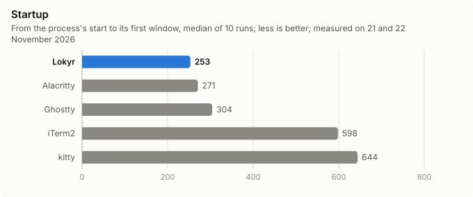
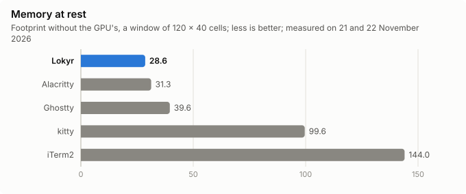
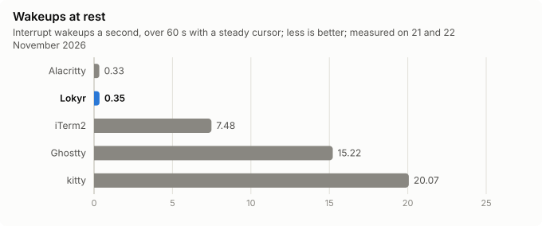
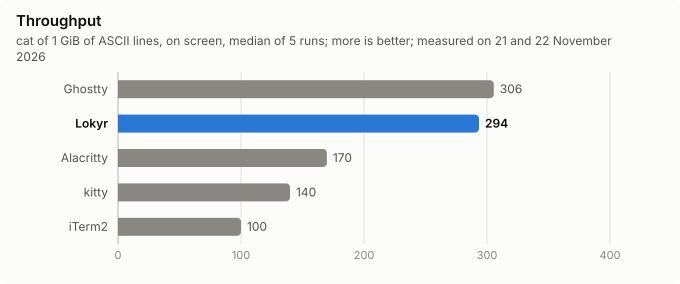
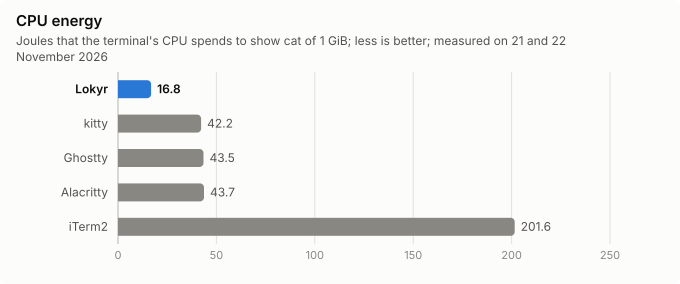
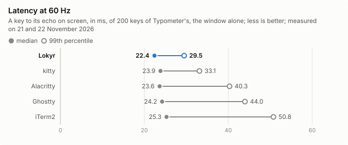

# Lokyr against the other terminals, of 1.4.0's code

Measured on 21 and 22 November 2026, from 23:08 to 01:17, on 1.4.0's bundle of commit 313f5a5a, against Ghostty, Alacritty, kitty and iTerm2, each of its version of that day, in one session, by the comparison's tool, `compare.py`, of [the first comparison](compare-F2-134.md)'s conditions and configs. WezTerm is left out, and Terminal.app too, whose profile `compare.py setup` writes by AppleScript, which timed out twice in the session; [the comparison of 13 November](compare-F3-268.md) tells both. The raw results are in [compare-F5a-78/](compare-F5a-78/), the session's script in [run.sh](compare-F5a-78/run.sh) and its log in [session.log](compare-F5a-78/session.log); `python3 tools/bench/compare_tables.py compare-F5a-78` makes the tables of the raw results, and `python3 tools/bench/report_charts.py compare` draws the charts, which the README shows.

The figures of this report compare within it alone. Every terminal's latency came 3 to 5 ms later at the median than on 13 November, and Lokyr's and Ghostty's `cat` some 7 % slower, of the same versions for Ghostty and Alacritty: the session's own, as 1.4.0's A/B found its output slower than the sessions before for both versions that it measured.

## In short

| Measure | Lokyr | Its place of 5 | The best of the others |
|---|---|---|---|
| Startup to the first window, median | 253.2 ms | 1st | Alacritty, 270.8 ms |
| Memory at rest, without the GPU's | 28.6 MB | 1st | Alacritty, 31.3 MB |
| Interrupt wakeups at rest | 0.35 a second | 2nd | Alacritty, 0.33 |
| `cat` of 1 GiB on screen | 293.5 MiB/s | 2nd | Ghostty, 305.5 MiB/s |
| The CPU's energy to show that GiB | 16.8 J | 1st | kitty, 42.2 J |
| kitty's benchmark, its six tests | The fastest, or within 1 %, in each | 1st | Ghostty, within 1 % in Unicode |
| A key to its echo at 60 Hz, median | 22.4 ms | 1st | Alacritty, 23.6 ms |
| A key to its echo at 60 Hz, p99 | 29.5 ms | 1st | kitty, 33.1 ms |
| A key to its echo at 60 Hz, next to a flood, median | 18.7 ms | 2nd of 4 | Alacritty, 17.6 ms |

The latency at 120 Hz was not measured again: [its chart](compare-F5a-78/charts/latency-120hz.svg) is the first comparison's, of 1 November 2026 and of the versions of then.

## Conditions

- **The machine**: an Apple M5 Pro (Mac17,8), macOS 27.2.1, on AC power; the main display a Dell P2721Q at 60 Hz, 5120 × 2880 pixels as 2560 × 1440 points, on which every window opened. Other apps stayed open, as on any working day; the load averaged 1.6 to 4.0 over the minute as each measure began, as the log tells.
- **Each terminal**: Menlo at 13 points, no ligatures, a grid of 120 by 40 cells, which `compare.py check` saw through `stty size` in each; a steady cursor, an opaque window without blur, about 10 000 rows of scrollback, no window restored, no shell integration: [the first comparison's configs](compare-F2-134/configs/). Lokyr's config turns neither smooth scrolling nor Blocks on, which are off by default.
- **The shell**: zsh with `ZDOTDIR` an empty directory, of its plain prompt, in each.
- **The defaults that the measures depend on**, left as they are: Ghostty's `window-vsync = true`; kitty's `input_delay 3`, `repaint_delay 10` and `sync_to_monitor yes`.
- **The versions**:

| Terminal | Version |
|---|---|
| Lokyr | 1.4.0's bundle of 313f5a5a, build 202611212117 |
| Ghostty | 1.4.0 |
| Alacritty | 0.17.0 (94e7c88), built of its tag, as Homebrew's cask is disabled |
| kitty | 0.51.0 |
| iTerm2 | 3.7.8 |

The startup, idle, memory and energy of Lokyr, kitty and iTerm2 came first, from 23:11 to 23:17, their throughputs again from 00:43 to 01:10 as the first try's were wrong: a window of Terminal.app, which `setup` had left open as its AppleScript timed out, came in front of kitty's and iTerm2's halfway through their runs, which then showed `cat` 3.4 times slower and vtebench's later scenarios 3 to 5 times, where every one of Lokyr's matched 13 November's; kitty and iTerm2 draw their output at the pace of their frames, which macOS slows in a covered window. `setup` now writes Terminal.app's profile only when it measures Terminal.app.

## Startup

`lokyr-bench startup`, which launches each terminal through LaunchServices and times its first window on screen from the process's start, a run to warm up and five, twice, the terminals' order turned between the rounds; and Lokyr's own first frame, as its presented handler tells it, in runs of its own. The spread is the range from the 10th to the 90th percentile, as a fraction of the median.

| Terminal | Median | p90 | Spread | Fastest | Slowest |
|---|---|---|---|---|---|
| **Lokyr** | **253.2 ms** | 266.0 | 0.21 | 211.6 | 268.2 |
| Alacritty | 270.8 ms | 284.9 | 0.09 | 248.8 | 297.5 |
| Ghostty | 304.2 ms | 314.9 | 0.13 | 264.7 | 320.8 |
| iTerm2 | 598.1 ms | 608.2 | 0.06 | 566.8 | 621.5 |
| kitty | 644.2 ms | 656.3 | 0.04 | 629.0 | 658.0 |

- Lokyr's first frame came at 239.2 ms at the median, p90 270.1, a spread of 0.14.
- Lokyr started 16 ms later than on 13 November, of a wider spread, its fastest run 211.6 ms; 1.4.0's A/B found its startup as 1.3.0's within 1 to 8 ms, which its measure at rest takes again. iTerm2 3.7.8 started 216 ms sooner than 3.7.7, kitty 16 ms later, Ghostty 8 ms later and Alacritty 3 ms sooner, of the same versions.

## At rest

Each terminal alone, 10 s after its start, then 60 s of `lokyr-bench idle` and of its energy, then its memory, over the processes of its bundle, without the shell, iTerm2's session server among them.

| Terminal | Processes | Package idle wakeups | Interrupt wakeups | Footprint without the GPU's | The GPU's | Energy |
|---|---|---|---|---|---|---|
| **Lokyr** | lokyr | 0 a second | 0.35 | **28.6 MB** | 30.6 MB | 0.08 mW |
| Ghostty | ghostty | 0 | 15.22 | 39.6 MB | 132.9 MB | 0.59 mW |
| Alacritty | alacritty | 0 | **0.33** | 31.3 MB | 53.4 MB | 0.08 mW |
| kitty | kitty, two kittens | 0 | 20.07 | 99.6 MB | 42.7 MB | 0.19 mW |
| iTerm2 | iTerm2, pidinfo and the session's server | 0 | 7.48 | 144.0 MB | 217.9 MB | 6.85 mW |

Lokyr is within its [budgets](../PERFORMANCE.md#budgets): no package idle wakeup, 0.35 interrupt wakeups a second, of ≤ 0.5, and 28.6 MB, of ≤ 35. Alacritty's 0.33 and Lokyr's 0.35 are 20 and 21 wakeups in a minute.

## Throughput

In each terminal's window, one after the other: kitty's `kitten __benchmark__`, three times without its `--render` and three times with it; vtebench, at commit ead8003, five seconds a scenario; and `cat` of 1 GiB of lines of ASCII, ended with a query of the cursor, five times.

### kitty's benchmark

Without `--render`, MB/s, the median of 3 runs; more is better:

| Terminal | ASCII | Unicode | Unique clusters of several codepoints | Short CSI sequences | Long escape sequences | Images |
|---|---|---|---|---|---|---|
| **Lokyr** | **305** | 302 | **118** | **236** | **307** | **307** |
| Ghostty | 303 | 304 | 104 | 229 | 306 | 304 |
| Alacritty | 104 | 118 | 66 | 91 | 208 | 213 |
| kitty | 177 | 172 | 56 | 114 | 270 | 253 |

- With `--render`, the figures are the same within 3 %, but Alacritty's, which are faster, 197 MB/s of ASCII, 261 of Unicode and 121 of short CSI sequences.
- The benchmark waits for an answer that iTerm2 never gives, and was left out of iTerm2's measures.
- Lokyr is the fastest in five tests and within 1 % of Ghostty in Unicode, 302 against 304 MB/s, as with `--render`, 308 against 305.

### vtebench

The median time of a scenario's samples, in milliseconds; less is better. vtebench's time ends as the PTY takes the bytes, not as the terminal shows them, in whole milliseconds:

| Scenario | Lokyr | Ghostty | Alacritty | kitty | iTerm2 |
|---|---|---|---|---|---|
| `dense_cells` | **4** | 4 | 5 | 8 | 126 |
| `medium_cells` | **3** | 4 | 6 | 7 | 387 |
| `scrolling` | **9** | 11 | 17 | 67 | 19 |
| `scrolling_bottom_region` | 9 | 12 | **8** | 32.5 | 537.5 |
| `scrolling_bottom_small_region` | 9 | 12 | **8** | 37 | 539.5 |
| `scrolling_fullscreen` | **10** | 14 | 33 | 155 | 34 |
| `scrolling_top_region` | 12 | **11** | 27 | 24 | 2 754 |
| `scrolling_top_small_region` | 9 | 12 | **8** | 32.5 | 535 |
| `sync_medium_cells` | **3** | 4 | 8 | 13 | 363.5 |
| `unicode` | **2** | 3 | 6 | 7 | 34 |

- Lokyr is the fastest, or as fast as the fastest, in six scenarios, and a millisecond of vtebench's whole ones behind Alacritty in the three of a small region, 9 against 8, and behind Ghostty at the top region, 12 against 11, within the budget.
- iTerm2 took only two samples of some scenarios in five seconds.

### `cat` of 1 GiB

| Terminal | Median | Its 5 runs |
|---|---|---|
| Ghostty | 305.5 MiB/s | 286.9 to 306.6 |
| **Lokyr** | **293.5 MiB/s** | 279.7 to 298.9 |
| Alacritty | 169.8 MiB/s | 165.8 to 170.0 |
| kitty | 139.8 MiB/s | 137.9 to 141.1 |
| iTerm2 | 100.0 MiB/s | 99.2 to 100.2 |

- Lokyr is at 0.96 of Ghostty's rate, within the budget, 10 % of the faster of Ghostty and Alacritty, as on 13 November, 0.97.
- iTerm2 3.7.8 ran `cat` at 100 MiB/s in its throughput's window, after vtebench, and at 58.1 MiB/s in the energy's run, in a fresh window, as 3.7.7 did both on 13 November, 59.9 and 59.1: its rate moves with how often it draws its window.

## Energy

`lokyr-bench energy`, which reads the energy that the kernel bills each process, `ri_energy_nj` of `proc_pid_rusage`, over `cat` of 1 GiB in each terminal: the same bytes in each, whatever its rate. The kernel bills the CPU's energy alone, which leaves out each terminal's own drawing on the GPU and the window server's composition.

| Terminal | A GiB | At |
|---|---|---|
| **Lokyr** | **16.8 J** | 308.8 MiB/s |
| kitty | 42.2 J | 139.2 MiB/s |
| Ghostty | 43.5 J | 292.4 MiB/s |
| Alacritty | 43.7 J | 161.7 MiB/s |
| iTerm2 | 201.6 J | 58.1 MiB/s |

Lokyr's CPU spends 0.39 of Ghostty's energy at about the same rate, as on 13 November, 0.41.

## Latency

Typometer 1.1.0's own benchmark typed 200 keys into each terminal, which ran `cat`, so that the terminal's echo of each key was the line discipline's, and timed each from its key to the change of the window's pixels that it reads from the screen: alone, and with a second window of the same terminal beside it, flooded by `yes`. Its settings: 200 characters, a delay of 150 ms between them, no intermediate pauses, its native API off and its synchronous mode. Its benchmark ran of Typometer's own jar, driven without its window by [a harness](../../tools/bench/typometer/Harness.java) and [a script](compare-F5a-78/latency/run-one.sh), which put each terminal's window at the screen's top left and the flooded one at its right, `compare.py open` opening each terminal in turn at its prompt, of the comparison's conditions, Lokyr as it starts rather than of its benches. At 60 Hz on the main display alone; Typometer could not find its reference pattern in iTerm2 next to a flood, as on 13 November, which has no figures. The raw results are in [latency/](compare-F5a-78/latency/). The median, the 90th and the 99th percentiles, by the nearest rank, in milliseconds; less is better:

| Terminal | 60 Hz, median | p90 | p99 |
|---|---|---|---|
| **Lokyr** | **22.4 ms** | **25.3** | **29.5** |
| Ghostty | 24.2 ms | 29.5 | 44.0 |
| Alacritty | 23.6 ms | 29.2 | 40.3 |
| kitty | 23.9 ms | 29.5 | 33.1 |
| iTerm2 | 25.3 ms | 39.5 | 50.8 |

| Terminal, next to a flood | 60 Hz, median | p90 | p99 |
|---|---|---|---|
| Lokyr | 18.7 ms | 24.9 | 40.8 |
| Ghostty | 33.3 ms | 35.7 | 42.4 |
| **Alacritty** | **17.6 ms** | 30.4 | **35.9** |
| kitty | 93.5 ms | 218.7 | 411.2 |

- **Alone**, Lokyr has the shortest median, p90 and p99, and no key past two refreshes, 33.3 ms, where 2 of kitty's 200 came later, 5 of Alacritty's, 11 of Ghostty's and 32 of iTerm2's.
- **Next to a flood**, Lokyr's keys came sooner than alone, 18.7 ms at the median, 11 of 200 past two refreshes, and Alacritty's too, 17.6 ms and 5; Ghostty's later, 33.3 ms, 99 past two refreshes. Lokyr's p99, 40.8 ms, is within the budget's 4.5 refreshes.
- **kitty next to a flood** took 93.5 ms at the median, 131 of its 200 keys past three refreshes.
- Every median alone came 3 to 5 ms later than on 13 November, Lokyr's 18.5 to 22.4 ms, kitty's 19.7 to 23.9 and Ghostty's, of the same version, 19.8 to 24.2: the session's, which `cat` in place of `cat > /dev/null`, of the same echo, and Typometer's benchmark run of its jar rather than of its window do not change.

## Since 13 November

Each terminal against its own figures of [the comparison of 13 November](compare-F3-268.md), of another session: a guide, not a measure of a change.

- **Lokyr**, 1.4.0's code against 0.9.0's of 1.0.0's: its startup 237.5 to 253.2 ms, its memory 27.8 to 28.6 MB, `cat` 317.5 to 293.5 MiB/s, as Ghostty's moved, its energy 16.9 to 16.8 J, its latency's median 18.5 to 22.4 ms and its p99 48.2 to 29.5.
- **iTerm2** 3.7.8 against 3.7.7: its startup 814 to 598 ms, its memory 147.9 to 144.0 MB, its energy for `cat` the same, 201.4 and 201.6 J.
- **kitty** 0.51.0 against 0.50.0: its startup 628 to 644 ms, `cat` 144.5 to 139.8 MiB/s, its benchmark the same within 7 %.
- **Ghostty** 1.4.0 and **Alacritty** 0.17.0, of the same versions: Ghostty's `cat` 327.7 to 305.5 MiB/s, Alacritty's 173.5 to 169.8; their startups 296 to 304 and 274 to 271 ms.
- **WezTerm** and **Terminal.app**, not measured in this session, had on 13 November `cat` at 42.7 and 43.9 MiB/s, a startup of 355 and 283 ms, and a latency's median of 63.3 and 18.4 ms.
