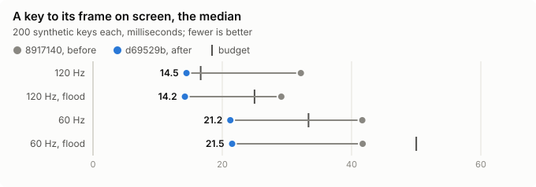
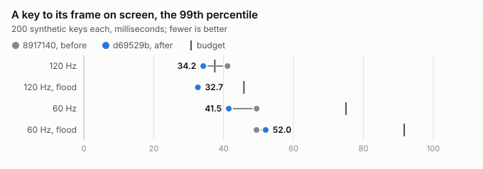
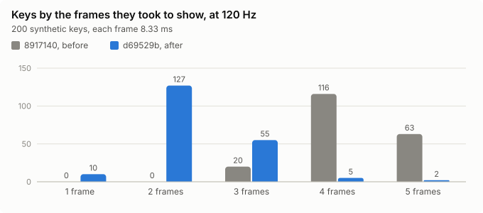

# Latency

Measured on 2026-10-31 with `lokyr --bench latency`, on the bundle of commit c121058, against the [budget](../PERFORMANCE.md#budgets) of a key to its presented frame: at 120 Hz, p50 ≤ 2 frames and p99 ≤ 3, a frame more next to a pane that floods its output. The raw reports are in [latency-F2-54/](latency-F2-54/).

## Method

- `lokyr --bench latency` opens a window whose program echoes each key, `cat` with the terminal in raw mode, as a shell's line editor does, and measures each press from the time that the system stamped on its event, `NSEvent.timestamp`, to the presentation of the first frame with new output after it, as the drawable's presented handler tells; a press waits for its frame alone, so that keys typed faster than their frames count once. It prints a histogram as JSON as it quits.
- **Synthetic keys**, `--keys 200`: the app posts each key to its own queue of events, as the keyboard's come, which needs no permission, one every 40 to 62 ms, so that they fall on every phase of the display's refresh. They leave out the way from the keyboard to the window server, about a millisecond.
- **Typed keys**: a person typed for about a minute in each case.
- `--flood` opens a second window, which `yes` floods.
- The machine's own config, the window centred on the main display.

## Machine

- Apple M5 Pro, macOS 27.2, on AC power, with Microsoft Defender scanning.
- 120 Hz: the MacBook's display, 3456 × 2234 pixels, ProMotion. 60 Hz: a Samsung U28E590, 3840 × 2160 pixels as 1920 × 1080 points; for the synthetic keys at 60 Hz, before the MacBook's display was opened, 6016 × 3384 pixels as 3008 × 1692 points.

## Results

| Rate | Keys | Flood | p50 | p99 | p50, frames | p99, frames | Budget, p50 / p99 frames |
|---|---|---|---|---|---|---|---|
| 120 Hz | synthetic | no | 32.2 ms | 41.1 ms | 3.86 | 4.93 | 2 / 3 |
| 120 Hz | synthetic | yes | 29.1 ms | 32.4 ms | 3.50 | 3.89 | 3 / 4 |
| 120 Hz | typed | no | 30.8 ms | 36.0 ms | 3.69 | 4.32 | 2 / 3 |
| 120 Hz | typed | yes | 29.1 ms | 34.2 ms | 3.49 | 4.11 | 3 / 4 |
| 60 Hz | synthetic | no | 41.7 ms | 49.5 ms | 2.50 | 2.97 | 2 / 3 |
| 60 Hz | synthetic | yes | 41.7 ms | 49.4 ms | 2.50 | 2.96 | 3 / 4 |
| 60 Hz | typed | no | 42.4 ms | 125.2 ms | 2.54 | 7.51 | 2 / 3 |
| 60 Hz | typed | yes | 44.8 ms | 59.4 ms | 2.69 | 3.56 | 3 / 4 |

- **The budget is missed** at both rates, at 120 Hz by about two frames at the median; with a flood, within its frame more at 60 Hz, not at 120.
- **The typed keys agree with the synthetic ones**, but for the 60 Hz case without a flood, whose p99 comes of 4 samples of 257, up to 386 ms, as the window was dragged to the external display before typing.
- **A flood costs nothing**, and at 120 Hz takes about 3 ms off: its window keeps the display link running, which the echo's frame then catches at its next refresh.

## Where the latency goes

A build that marked the commit of the frame that shows the key, outside the measures, of synthetic keys:

| Rate | Key → the frame's commit | The commit → the display |
|---|---|---|
| 60 Hz | median 10.0 ms, 1.1 to 18.0 | 31.8 ms, 31.4 to 32.5: 2 frames |
| 120 Hz | median 5.7 ms, 1.1 to 16.8 | 24.1 ms, 23.0 to 32.3: 3 frames |

- **The echo's frame waits for the display link**: the key's own request of a frame, which starts its cursor's blinking again, takes the frame that is due at once, as the link was paused, and starts the link, so that the echo, a millisecond later, waits for the next refresh. At 120 Hz the wait reaches 16.8 ms, two refreshes, as ProMotion runs the link slower while little changes.
- **From the commit to the display**, macOS's composition of the window takes about 24 ms at 120 Hz and 32 ms at 60 Hz, as constant as the display's refreshes: 3 frames at 120 Hz, 2 at 60, which no frame drawn at once comes under.
- The next change takes the echo's frame at once, the display link's rate, and the composition's path, as `presentsWithTransaction` shortens it, and measures again; the budget is to revise if the system's part keeps it out of reach.

## After the keys' frames came sooner

The Metal layers present without the display's sync, and a key that the bench posts wakes the main run loop, as the keyboard's does. On commit 7796b52, synthetic keys, the window on the main display:

| Rate | Flood | p50 | p99 | p50, frames | p99, frames | Budget |
|---|---|---|---|---|---|---|
| 120 Hz | no | 14.5 ms | 34.2 ms | 1.74 | 4.10 | 2 / 4.5 |
| 120 Hz | yes | 14.2 ms | 32.7 ms | 1.71 | 3.92 | 3 / 5.5 |
| 60 Hz | no | 21.2 ms | 41.5 ms | 1.27 | 2.49 | 2 / 4.5 |
| 60 Hz | yes | 21.5 ms | 52.0 ms | 1.29 | 3.12 | 3 / 5.5 |

The charts come of the raw reports, through `python3 tools/bench/report_charts.py latency`.

- **The median halved**, at 120 Hz from 32.2 ms to 14.5, at 60 Hz from 41.7 ms to 21.2: from the commit to the display, 6.7 ms at the median at 120 Hz, where it took 24, and 9.6 at 60, where it took 32. No torn frame showed, in a window or in full screen, of a screen that fills and empties in synchronized updates, nor in `less` and `vim`.
- **The 60 Hz figures** come before the run loop's wake after a posted key, which shortens the tail of the keys' delivery, not their median.
- **The p99 at 120 Hz**, 4.1 frames, is macOS's composition, which now and then takes 24 ms from the commit to the display: a display link that never stops, which keeps ProMotion at its full rate, made the median worse, 17.6 ms, as the echo's frame waited for its tick, and left the tail; presenting with Core Animation's transaction took a frame more, 48 ms at 60 Hz. The budget's p99 became 4.5 frames at 120 Hz on 31 October 2026.
- **What was not needed**: a key's own frame, which starts its cursor's blinking again, does not delay the echo's, as the echo's request finds the display link stopped; the wait was the key's delivery to the app.
