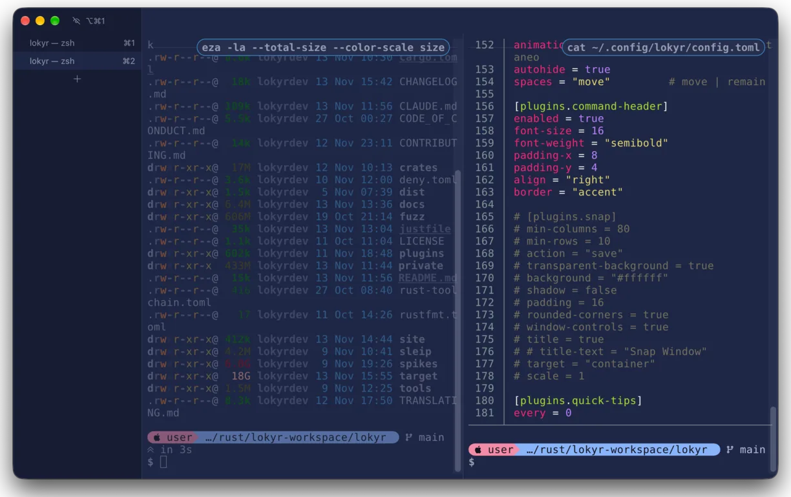
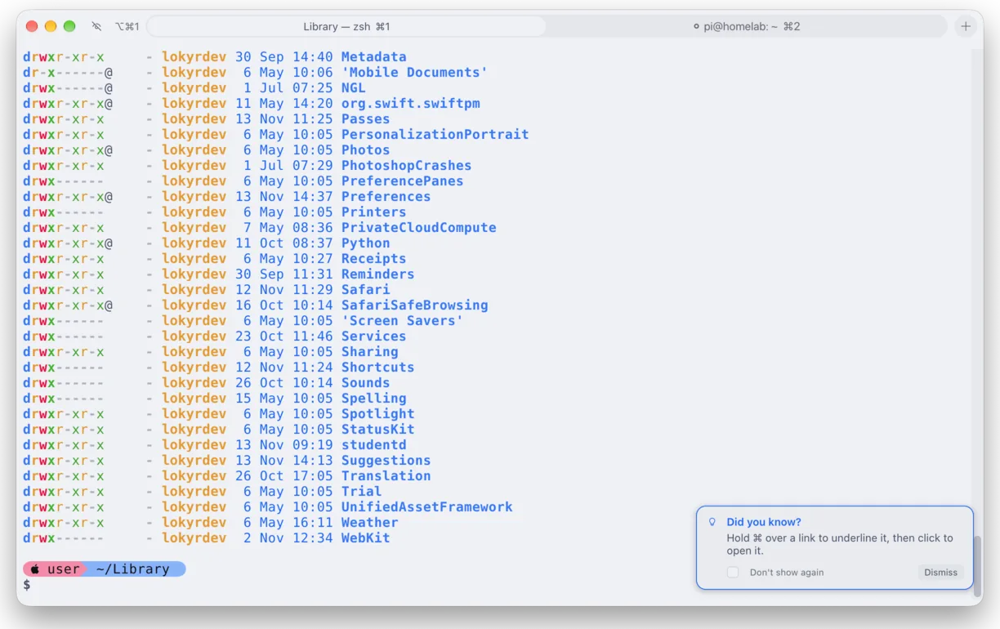
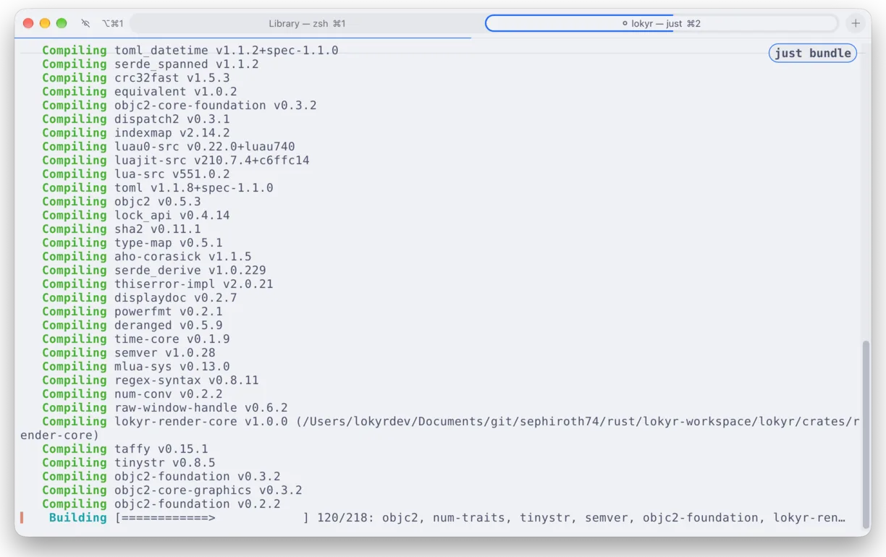
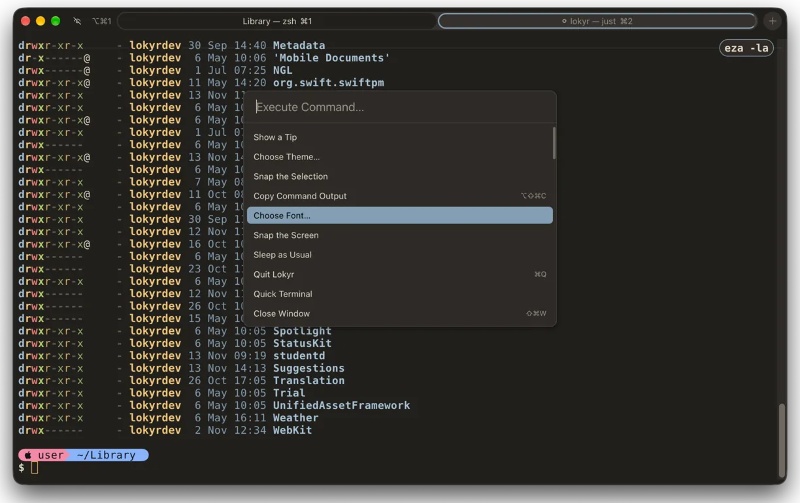
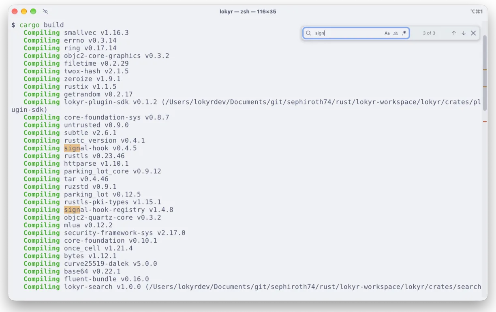
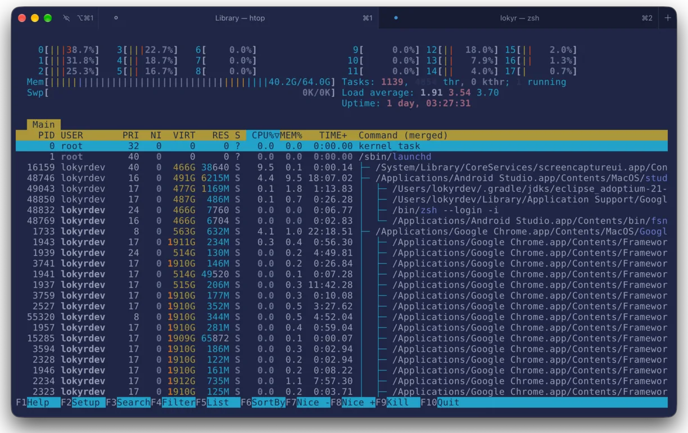
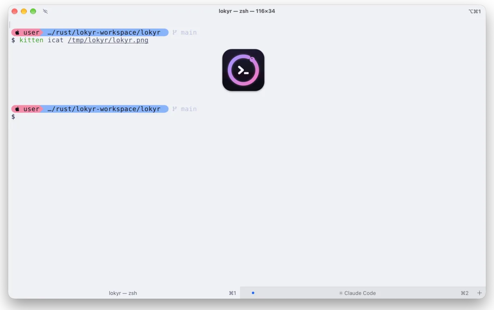
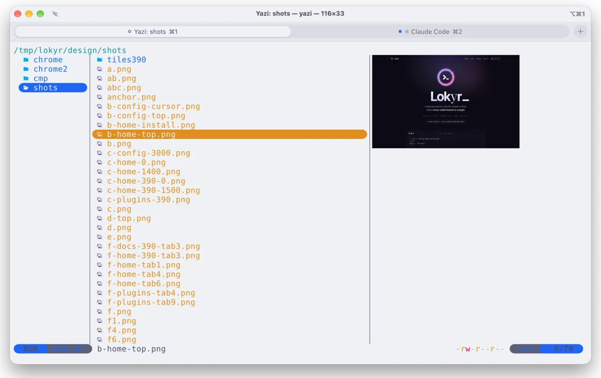

# Screenshots

Lokyr on macOS, each window as it shows: splits and tabs, the command palette, find, a program's progress, themes and inline images, of the plugins that come with it.

## Splits and a column of tabs

Two panes side by side and the tabs down a column at the window's left. Each pane shows at its top the command whose output you are reading, once its line has scrolled away, and the pane without the keyboard fades.

## Tabs and a quick tip

Tabs in the titlebar, the one whose program runs marked by a ring. As Lokyr starts, once a week at most, a card at the window's bottom right tells a shortcut or a feature that no menu shows.

## A build's progress

A program that tells its progress, as cargo does, fills a thin bar across the window's top and the outline of its tab, and the command that runs shows at the pane's top.

## The command palette

Every command, the plugins' too, in one list ranked as you type, each with its keys: ⇧⌘P opens it.

## Find

A pane's screen and scrollback searched as you type, every match highlighted and counted, with the options of case, whole words and regular expressions: ⌘F.

## Themes

htop in one of the 278 themes that come with Lokyr, the tab bar in the theme's own colours. Your own iTerm2 `.itermcolors` files work as they are.

## Inline images

Pictures in the terminal, as `kitten icat` and `imgcat` send them, of kitty's and iTerm2's protocols; here the tab bar sits at the window's bottom, Claude Code in the other tab.

## Previews in a file manager

yazi previews an image beside its file list, of kitty's graphics protocol, as other terminal file managers do.

